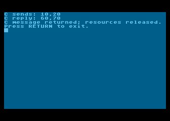
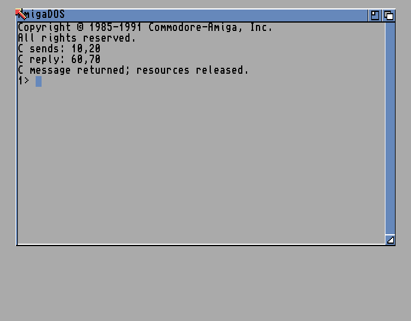

# Exec816

Exec816 is a small Amiga Exec-inspired multitasking system for the WDC 65C816,
written mainly in Action!. It provides Tasks, signals, message ports, memory
allocation and asynchronous device I/O, with DOS, filesystems and a shell built
on those services.

You can try Exec816 in the AltirraSDL emulator. The demo download and setup
instructions are below.

Version 0.2 boots through [OF816](https://github.com/mgcaret/of816) into a
640×240 colour GEM desktop with folder windows and a windowed Shell. Control
Panel, Calculator, Text and Counter launch on demand. The desktop includes
menus, window switching and iconification, file copying and drag-and-drop.
The Shell provides disk-loaded commands and two-command pipes. `SYS:` is
read-only, `WORK:` is a writable disk, and `RAM:` is temporary storage.

## Installation

Download `exec816-demo.zip` from the
[Releases page](https://github.com/mkur/exec816/releases) and extract it.
Published previews can predate the current desktop; follow the README inside
their archive. The instructions below describe the 0.2 GEM desktop build,
available through the [build guide](docs/contributing/building.md).
Its `exec816-demo/` folder contains:

| File | Purpose |
| --- | --- |
| `Exec-of816.xex` | Exec816 and the OF816 boot monitor |
| `system.atr` | System disk with commands and sample files |
| `work.atr` | Disposable writable disk for D8: |
| `altirraos-816.rom` | Matching AltirraOS 3.44 ROM for 65C816 |
| `README.txt`, license notices and `SHA256SUMS` | Boot instructions, licenses and checksums |

Use [AltirraSDL](https://github.com/ilmenit/AltirraSDL) with these settings.
Upstream Altirra will not run this build. The exact tested emulator build is
recorded in the [GEM platform pin](toolchain/altirra-gem-vdi.json).

Current builds require **4 MB of RAM**: **64 KiB base RAM plus 4,032 KiB of
linear high memory (63 banks)**. These are CPU high banks, separate from Atari
extended memory and VBXE VRAM.

These steps use AltirraSDL's desktop interface. Open **System → Configure System…**.
The first column below gives the page in the settings window's left-hand tree.
Select the CPU before setting high memory.

| Settings page | Control | Value |
| --- | --- | --- |
| Computer → System | Hardware type | Atari 800XL |
| Computer → System | Video standard | PAL |
| Computer → CPU | CPU selection | **65C816 (14.28MHz)** (8× speed) |
| Computer → CPU | Shadow ROMs in fast RAM | Checked |
| Computer → Memory | Memory Size | **64K** |
| Computer → Memory | High memory banks | **4032K** (63 banks above the base RAM) |
| Computer → Firmware | Operating system | The included `altirraos-816.rom`; import it as described below |
| Computer → Firmware | Enable internal BASIC (boot without Option pressed) | Unchecked |
| Devices | VBXE | FX 1.26 at `$D600`, with 512 KiB private VRAM |
| Input | Controller on port 1 | ST mouse |
| Computer → Acceleration | SIO Patch | Unchecked |
| Computer → Acceleration | D: burst I/O | Unchecked |
| Computer → Boot | Unload disks when booting new image | **Unchecked**, so booting the XEX keeps the system disk mounted |

To import the ROM, open **Computer → Firmware → Firmware Manager… → Add…**
and choose the extracted `altirraos-816.rom`. In **Edit Firmware Settings**, name
it **Exec816 AltirraOS**, set **Type** to **XL/XE OS**, and click **OK**. Close the
Firmware Manager, then select **Exec816 AltirraOS** in **Operating system**.

1. Close the settings window. Open **File → Disk Drives…** and click the **…**
   button on the **D1:** row to select the extracted `system.atr`. Mount a
   disposable copy of `work.atr` in **D8:** with writes enabled.
2. In the same **Disk drives** window, set **Emulation level** to
   **Generic + 57600 baud**. This setting applies to all drives.
3. Choose **File → Boot Image…** and select `Exec-of816.xex`. The ATR is the
   data disk; the XEX starts the system.
4. Wait five seconds for OF816 to start Exec816. To enter the Forth monitor,
   press a key during the countdown; type `EXEC816` to continue booting.

Wait for the desktop and `SYS: -> D1: ready, read-only` in the Shell.
Double-click a volume icon to browse files. Use Desk to launch applications,
and Windows or Ctrl-Tab to switch between them. Click the Shell before typing:

```text
TASKS
MOUNT
CD SYS:
DIR
HELLO
TYPE README.TXT
MEM
HELLO | WC
CAT STORY.TXT | WC
```

Type `HELP` to list the Shell's built-in commands, or `VER` to show the release
version, source commit and compiler pin.

`HELLO | WC` prints `1 3 17`: lines, words and bytes. Press **BREAK** to cancel
a running command, or enter `EXIT` to stop the demo and restore the OS screen.
SYS: is read-only and WORK: is writable. Try `ECHO saved >WORK:OUT.TXT` followed
by `CAT WORK:OUT.TXT`. Redirection creates or truncates its target when opened.
Keep both disks mounted until shutdown; if startup fails, check D1, D8 and their
SIO settings, then cold-boot again.

See the [GEM desktop guide](docs/gem-desktop-distribution.txt) for desktop controls and the
[boot monitor guide](docs/guides/boot-monitor.md) for system-drive and cache settings.

## The same C example on Exec816 and Amiga

The standalone [messages.c](c/examples/messages.c) example compiles from the
same source for Exec816 with Calypsi and for classic AmigaOS with vbcc. It uses
the familiar Exec calls and headers, with no platform conditionals in the example.

The main task creates a worker with `CreateTask` and sends it a message containing
`10,20`. The worker adds 50 to each value and replies with the same message:

```c
WaitPort(port);
request = (struct XYMessage *)GetMsg(port);
request->x += 50;
request->y += 50;
ReplyMsg(&request->message);
```

The main task receives `60,70`, releases its resources and prints through
AmigaDOS-style `Output()` and `Write()`. Signals coordinate worker startup and
completion. Exec816 supplies a small C binding to its native services.

Both screenshots show **one run of the same C source**:

<table>
  <tr>
    <th width="50%">Exec816 / Calypsi 65816</th>
    <th width="50%">AmigaOS / vbcc m68k</th>
  </tr>
  <tr>
    <td valign="top"></td>
    <td valign="top"></td>
  </tr>
</table>

The Amiga run uses FS-UAE with an A500+ and Kickstart 2.04. This demonstrates
source compatibility for the supported Exec and DOS calls; Amiga binaries and
the full AmigaOS API are outside the current scope.

Follow [One C example on Exec816 and classic Amiga](docs/guides/amiga-c.md) to
build and run both versions. The [Calypsi guide](docs/guides/calypsi-c.md) lists
the available C calls and binding details.

## Build from source (optional)

To build your own distribution, install the prerequisites and pinned compiler,
emulator bridge and ROM described in [Build from source](docs/contributing/building.md).
Then run from the repository root:

```sh
python3 tools/build_demo.py --gem-desktop --release-compiler --output build/demo
```

This produces `build/demo/exec816-demo.zip`. Follow the [installation steps](#installation)
above to run it.

## Documentation and development

- [Try the GEM desktop](docs/gem-desktop-distribution.txt) — setup, boot and desktop controls.
- [Read the documentation](docs/README.md) — guides, architecture and API reference.
- [Understand the system](docs/architecture/overview.md) — what runs where and why.
- [Build from source](docs/contributing/building.md) — pinned tools and artifacts.
- [Write a command](docs/guides/commands.md) or try the [C example](docs/guides/calypsi-c.md).
- [See the remaining work](docs/roadmap.md).

The kernel and libraries are in [lib/](lib/README.md), machine-specific code in
[platform/](platform/), and applications in [examples/](examples/).
[actionc](https://github.com/mkur/actionc) owns the language and compiler; the
[compiler pin](toolchain/actionc.json) selects the revision used here.

Contributions follow the [repository instructions](AGENTS.md),
[Action! style guide](docs/contributing/style.md) and
[two-tier testing policy](docs/contributing/testing.md).

## License

Exec816's OS code is **GPL-3.0-only**. Public C and Action! bindings, headers,
ABI definitions and examples are **MIT-licensed**; the resident shell remains
GPL. Independent applications may use the public interfaces under their own
licences, including when bundled in the same boot image.

See the [file-level licence map and application permission](LICENSING.md),
the [GPL text](LICENSE) and the [MIT text](LICENSE-MIT). Third-party components
retain their own notices and licences.
