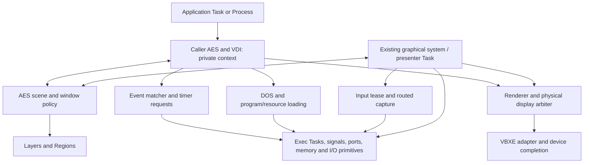

# Mapping MagiC's architecture to Exec816

[Standalone MagiC model](magic.md) · [Architecture index](README.md) ·
[Source and mapping evidence](../development/magic-exec-mapping.json)

This analysis maps the pinned Atari MagiC model onto Exec816 revision
`4fd56448`. It distinguishes existing foundations, required adaptations and
unsupported behavior. It changes no implementation or public contract.
The standalone model remains the description of MagiC itself.

## Architectural fit

MagiC's GEM responsibilities fit above Exec's existing execution, communication,
memory, I/O and application-lifetime services. Its tree/object/primitive/device
hierarchy is useful independently of its embedded scheduler and Atari trap
environment. The present Exec implementation already combines caller-context
AES/VDI work with one graphical system loop in the existing presenter Task.
This is a usable foundation for structural simplification.

The inspected MagiC paths use direct pointers and resident shared state. Exec
also shares one address space, so this mapping does not require an IPC boundary
around every object helper or a serialization format for every internal call.

For the covered GEM responsibilities, this analysis identifies no requirement
for a second scheduler, another interrupt-input stack or a new private kernel
operation. It does identify substantial adaptations in preemption/shared state,
message semantics, lifecycle and UI policy. This is an architectural conclusion
from the inspected contracts and implementation, not a performance measurement.

The most useful decomposition is MagiC's APPL record. Its saved execution belongs
to an Exec Task; its process association belongs to Process/DOS lifetime; its
menu, window, input and event state belongs to an AES application context. Those
roles are already represented separately here. Preserving that split avoids
importing a second execution model together with otherwise reusable GUI policy.

## Foundations that can be reused

The distinction between kernel primitives and resident libraries matters here.
An ordinary library call can run in its caller, including when the library is
resident. Neither an AES operation nor a graphics primitive inherently requires
a kernel entry or a request to a GUI worker.

| MagiC responsibility | Reusable Exec foundation | Existing integration and remaining responsibility |
| --- | --- | --- |
| APPL execution and context switching | `Task`, task admission, saved context, `Wait`, `Signal` and `Yield` | AES registration/context is attached to an existing Task. Keep GUI identity, focus and scheduling identity separate. |
| DOS process/basepage role | `PROCESS`, per-Task DOS contexts, inherited handles/directory and loaded `Image` ownership | Use a Process for program/DOS lifetime. Plain system Tasks need no synthetic Process merely to perform AES work. Shared-process APPL threads require a separate design. |
| Application and control messages | Exec FIFO ports, stable Message records and signals | Existing AES copies eight GEM words into destination-owned records, then uses `PutMsg`. Payload copying, capacity, GUI coalescing and retirement stay in AES. |
| Keyboard, pointer and deferred event capture | Public `INPUT` leases, routes, retained notifications and native IRQ/NMI publication | The existing presenter consumes physical input. AES translates/routes it and publishes durable client state; applications do not install another BIOS input handler. |
| Event matching and combined waits | `Wait` over owned signal masks, AES input/message state and `ExecAESWait` | Reuse the current caller-side matcher. It can combine GUI/timer readiness with child/I/O notifications without consuming someone else's completion records. |
| Timers and timeout wakeups | `timer.device`, asynchronous device requests and monotonic deadlines | Existing AES timed waits use one retained alarm when needed. The timer driver needs no worker Task; preserve abort/collection and rate conversion. |
| Memory and list storage | `AllocMem`, `FreeMem`, `AvailMem`, `EXECLISTS` and upper RAM | Reuse allocation and list operations. AES still owns its object lifetimes and synchronization. Task removal is not a heap-allocation group free. |
| File access, directory scans and resource loading | Native DOS, filesystem/SIO services and existing caller-side resource/scan bindings | Keep file waits in application/loading contexts. Reuse RSC byte-order, pointer and bitmap conversion rather than importing Atari DOS calls. |
| Executable loading and launch | Native C program loader, resident provider imports, Process start/collect and image retention | APP ABI 36 already supplies normal C entry and shared services. This is rebuilt source compatibility; Atari executables and trap layouts are a different contract. |
| Screen-manager execution | Existing `AESSYSTEM` loop and presenter Task | Reuse its input/menu/gesture/window-continuation role. UI focus remains AES policy, independently of which Task receives CPU time. |
| UPDATE, MCTRL and scene access | `AESLOCKS`, `AESWAIT`, `AESGATE`, short Task guards and ordinary signals | Existing library policy already implements waitable ownership. Preserve its documented semantics or migrate them explicitly; do not substitute a long scheduling exclusion. |
| Window visibility, overlap and damage | `LAYERS` and `REGIONS` ordinary libraries, used with one serialized shared scene | Reuse geometry and damage operations below AES window policy. AES and the scene refer to one authoritative window record set. |
| Workstation and object drawing | Current private C workstation/context, prepared object data and ordinary renderer calls | Keep tree/layout and workstation state separate from shared device scratch. MagiC can guide the call structure without replacing these foundations. |
| Physical screen access and device execution | `DISPLAY` lifetime ownership/delegated access and the VBXE driver | Reuse serialized hardware access, completion, scratch/VRAM discipline and fault retention. They are below GEM's semantic drawing operations. |
| Terminal/console behavior | Console instances, streams, copied console views and the loaded GEM Terminal | Reuse the text model and input bindings. Terminal painting uses normal AES/VDI; it does not require restoring a second native window manager. |

Authoritative interfaces: [Tasks](../reference/tasks.md),
[signals](../reference/signals.md), [ports](../reference/ports.md),
[device I/O](../reference/device-io.md), [timer](../reference/timer.md),
[memory](../reference/memory.md), [lists](../reference/lists.md),
[Processes](../reference/process.md), [DOS](../reference/dos.md),
[C images](../reference/c-program-loading.md), [input](../reference/input.md),
[Layers](../reference/layers.md), [display](../reference/display.md),
[AES](../reference/aes.md) and [console views](../reference/console-views.md).

Useful existing implementation seams include
[`aes-local.c`](../../c/calypsi/aes-local.c) / [`aeslocal.act`](../../lib/aes/aeslocal.act),
[`aes-events.c`](../../c/calypsi/aes-events.c),
[`aes-messages.c`](../../c/calypsi/aes-messages.c),
[`aesgate.act`](../../lib/aes/aesgate.act),
[`aeslocks.act`](../../lib/aes/aeslocks.act),
[`aessystem.act`](../../lib/aes/aessystem.act),
[`display-access.inc`](../../lib/display/display-access.inc) and
[`gem-vbxe.c`](../../ports/gem4xe/adapter/gem-vbxe.c).
These are existing implementations, not a claim that every interface between
them is already general or minimal.

## Execution and responsibility map



This diagram groups existing roles. It proposes no additional worker or new
kernel dispatch layer. A caller can calculate object geometry, match events,
read resources and perform eligible metadata work on its own stack. Shared
scene access is serialized separately; physical continuation/input work uses
the existing system Task. Driver entry and IRQ completion follow their own
documented protocols.

The AES system Task, native device workers and application Tasks are all Exec
Tasks. Window records, virtual workstations, ports, timers and console instances
are objects with independent lifetimes; creating another one does not inherently
justify another execution context.

## Mismatches that require adaptation

### Preemption and ambient graphics state

The inspected Atari MagiC timer avoids suspending an application interrupted in
supervisor mode. Ordinary trap code consequently has a different preemption
environment from Exec's caller-context C/Action! libraries. MagiC also explicitly
schedules from waits and AES returns, so even its source does not establish that
all global state is safely held across every complete API call.

Exec must retain normal Task preemption and its IRQ/NMI context protocol.
`Forbid` excludes Task scheduling, permits interrupts, and a blocking `Wait`
can still let another Task run before restoring the caller's nesting. It is
unsuitable as the lifetime of a redraw, modal form or UPDATE session.

Existing per-Task parameter arrays, prepared object state and workstation state
can be reused. Shared clipping arrays, staging, command lists, cursor saves and
device state still need explicit ownership. A pure calculation can use caller
state outside physical access; shared device-state mutation belongs inside an
admitted drawing unit. Preemption alone does not release a held display grant.

**Consequence:** extract MagiC's semantic hierarchy while making state lifetime
and handoff explicit. Neither a whole-tree physical grant nor a smaller fixed
strip follows automatically from that hierarchy. Command-list capacity can cause
an internal drain without ending the semantic operation or transferring access.
Measure ownership and responsiveness before changing those boundaries.

### Three different kinds of ownership

The current implementation already separates the following roles:

| Role | Purpose | Waiting and completion rule |
| --- | --- | --- |
| UPDATE / MCTRL | Logical application painting and mouse/gesture policy | Can span calls and CPU handoffs; use AES waitable ownership and matching releases |
| Scene gate / Layers transaction | Serialize geometry, visibility, routing publication and damage metadata | Drop the scene gate before physical work, route/resource operations or renderer callbacks; event waits hold no Layers transaction |
| Display access / device operation | Protect renderer scratch, cursor saves, DMA and hardware state | Retire dependent hardware and scratch use before release; a trusted borrowed drawing callback cannot wait for an event or issue AES RPC |

The display's retained lifetime owner is another association: it can delegate
physical units while retaining responsibility for shutdown and hardware recovery.
A VDI workstation identifies attributes/target state, not any of these ownership
roles. Combining them would turn ordinary waits or expensive rendering into
unnecessarily broad exclusions and can create dependency cycles.

The current system can dispatch published input and device completion while
scene-dependent continuation work is deferred. Preserve that separation when
reorganizing the drawing path. A synchronous driver fence is a bounded hardware
completion operation under physical ownership; an application event or file
wait is a different kind of blocking operation.

### UPDATE and modal semantics already differ

In MagiC, `BEG_MCTRL` acquires the recursive UPDATE blockage and additionally
saves/replaces menu and input routing. The final UPDATE release publishes the
oldest waiter's ownership before signaling its event.

Exec's AES maintains update and mouse holds separately. `BEG_UPDATE` acquires
update ownership and an implicit mouse hold; explicit MCTRL has its own hold.
Eligible waiters are signaled and recheck/acquire in their caller context.
Owner recursion and a mouse-owner upgrade can affect eligibility. These rules
are documented behavior, not an interchangeable copy of MagiC's counters and
semaphore handoff.

The difference also reaches forms. MagiC's inspected modal form loop retains
mouse-control coordination across event waits. Current Exec forms use an owned
or temporary ordinary window and acquire UPDATE for painting. Desktop-wide modal
ownership is unsupported. Adopting a MagiC structural model therefore requires
an explicit decision about these semantics before changing the lock machinery.
This analysis preserves the current contract.

### Signals, queues and copied messages

Exec signals are coalescing notification bits. They cannot replace the APPL's
backing event/message state or encode one durable occurrence per post. Keep
input records, redraw facts, queued messages and timer completion state above
the wake bit. Publish interest before the last readiness check; retain early
notifications and recheck after waking.

Exec ports enqueue caller-supplied Message references. MagiC's ordinary
`appl_write` copies bytes and allows the sender to reuse its source buffer.
The current AES destination-owned record pool is the required semantic adapter:
copy, publish through `PutMsg`, then recycle after reception. Passing an
application's temporary eight-word buffer directly as an Exec message would
change both layout and lifetime semantics.

Similarly, `ExecAESWait` can observe caller-owned completion bits, but leaves
external ports and child/I/O collection to their owners. A GUI event loop must
not consume a Process or device reply merely because its wake bit was selected.
MagiC's memory-attached message extension is not implemented by the current
ordinary eight-word AES delivery contract.

Input qualifiers/buttons, loss handling and timer resolution also follow the
current native/AES contracts. Reusing their delivery and wait machinery does
not establish exact Atari input or timing equivalence. Keep those behavioral
differences explicit when extending the supported GEM subset.

### Process cleanup and asynchronous users

MagiC records process-associated memory ownership and has application/thread,
signal and termination machinery. Exec Process cleanup closes its documented DOS
objects and retains image ownership through retirement/collection; arbitrary
heap blocks still require explicit release. `RemTask` is not an application
resource collector. A Task lease also does not retain every port, callback,
signal or buffer reachable from that Task.

Reuse the current loaded-application wrapper: attach/register AES before entry,
detach and settle GUI/resource/timer users on return, then perform DOS cleanup
and Process retirement. If teardown cannot complete, it retains the Task/image;
it does not force an unsafe unload. `RequestStop`/BREAK are cooperative.

**Consequence:** retain explicit retirement of input routes, message publishers,
windows, timers, renderer references and callback/image users. GUI identity or
Task-slot reuse must not revive stale ownership. MagiC-style forced termination,
shared-process threads and execution of asynchronous signal-handler callbacks
have no automatic one-for-one mapping to this Process/Task contract. Native
signal bits do not supply POSIX-style signal-handler execution.

### Callback and re-entry contracts

MagiC's USERDEF objects, extended forms, menu extensions and frame callbacks add
arbitrary or indirect execution edges. Current Exec object drawing supports
linked trusted renderer callbacks; application drawing callbacks, indirect
object specifications and recursive forms are outside the supported contract.
The C binding's `busy` state deliberately rejects a second public operation
on the same occupied context, while private helpers reuse the admitted context.

Copying MagiC callback placement into a physical drawing callback would allow
code to wait, make an RPC or re-enter a non-reentrant renderer with shared scratch
live. Future callback support needs a deliberate calling-context, nesting,
ownership and code-lifetime protocol. It cannot be inferred from the availability
of C function pointers or a loaded image. Retaining current unsupported behavior
does not block restructuring the built-in object path.

### Geometry, workstations and platform representations

`LAYERS` is reusable for visibility/damage, but its bounded opaque rectangles,
half-open coordinates and in-screen geometry do not implement every MagiC window
or raster convention. Keep conversion and window/frame policy in AES. A separate
translated window manager must not create another authoritative stacking or
geometry model beside the existing scene/window records.

The same applies to the device boundary. MagiC's Atari screen/offscreen functions
cannot be treated as implementations of packed VBXE pixels, command staging or
MEMAC mapping. Reuse the existing backend, list/work limits, dependency fences,
timeout recovery and reset-required ownership retention. Their completion and
IRQ/NMI rules remain in the driver/adapter, rather than becoming AES-private
kernel services.

GEM source records and resource formats also differ from native bindings.
Exec's Action! pointers occupy three bytes; the C profile uses huge-data pointers
and explicit bridges. Standard RSC words/longs are big endian. Existing resource
loading performs byte-order, address and planar-image conversion. Reusing public
interfaces and those converters avoids accidental structure casts, Atari trap
assumptions and repeated pointer validation through each layer. Live storage
and correct API use remain caller responsibilities after admission.

### Capacity and scheduling assumptions

The standard map has twelve public Tasks including root/services, plus private
idle. AES separately permits four registered clients, eight context bindings and
six windows; Layers permits eight opaque layers plus a permanent background.
These are different capacities.
A waiting Task retains its stack/DP slot. A small admitted ordinary worker pool
reserves 1,600 bank-zero bytes, including its DP and guards; a large pool reserves
2,848. The standard pools already exist and cannot grow dynamically.

Reuse the existing system Task and ordinary caller contexts. Per-window,
per-workstation, per-message or per-timer Tasks would consume scarce execution
storage without following the ownership model of those objects. Current Exec
Task priorities do not affect scheduler selection, so MagiC scheduling/priority
behavior cannot be assumed even when application-level behavior is similar.

Source authority for these counts is the [Task capacity](task-capacity.md)
guide, [AES ABI](../../abi/aes-server.json), [Layers ABI](../../abi/layers.json)
and [C image ABI](../../abi/c-program.json). Some narrative summaries, including
the DOS reference's C ABI label, still describe smaller maps or older ABIs.
Their numerical summaries were not used as current capacity/version authority
for this analysis.

## What belongs where

| Responsibility | Architectural home |
| --- | --- |
| Scheduling, context preservation, signal/port publication, generic memory and I/O primitives | Existing Exec kernel and public bindings |
| Process/DOS/image lifetime, deadlines, input acquisition, console models and display arbitration | Existing resident libraries, services and platform adapters |
| GEM IDs, copied messages, event matching, UPDATE/MCTRL, focus, windows, menus, forms, resources and workstation semantics | AES/VDI libraries and the existing graphical system Task |
| Visibility/damage geometry | Layers/Regions under AES's serialized scene ownership |
| VBXE mapping, list construction/submission, device dependencies, quiescence and fault retention | Renderer/backend and device adapter, using public coordination primitives |

The supported public Exec interfaces inspected here do not expose an Amiga
`SignalSemaphore` or MagiC `BLOCKAGE` service. Existing AES locks already compose
short guards, durable waiter state and `Wait`/`Signal`. That is sufficient for the
current UI ownership semantics. A reusable waitable-lock library could be
factored if multiple subsystems need it; its semantics and measured benefit must
be established before adding another abstraction. A combined kernel operation
would require a general public contract and ownership rules, rather than a
private AES-only fast path.

Keep ordinary pure helpers as direct calls. Preserve the existing selective
caller/system split: loading and application event waits can block in their
callers, while the system Task continues routing input and retiring physical
work. A monolithic AES server performing synchronous application file waits
would introduce head-of-line blocking even though Exec itself remains preemptive.
Existing private continuation and scene protocols still need explicit migration
if their structure changes; this analysis does not declare them replaced.

## Implications for subsequent structural work

Use the MagiC hierarchy to identify five existing roles: application context,
window/scene state, semantic redraw operation, workstation and physical device
access. These are analysis roles, not a proposal to allocate five new records.
Map the current call chain and state lifetime against them before changing code.

Preserve caller-private preparation, direct internal calls and one authoritative
scene. Keep semantic drawing progress separate from list drains, physical grants
and CPU handoffs. Establish resource/operation inputs at the appropriate entry;
retain synchronization and ordinary operational errors without introducing
repeated validation wrappers. Change one complete path at a time using existing
GEM callers and backend facilities.

Acceptance of a later change requires correct clipped pixels, durable events,
safe callbacks/lifetimes, bounded completion and cleanup. Compare total work,
ownership transitions, CPU, input responsiveness and peer progress, along with
code/heap/stack and fixed/per-Task bank-zero costs. Fewer calls, fewer grants or
a shorter source file alone would not establish a better implementation.

## Evidence and validation scope

The source record identifies the standalone MagiC model and pins current Exec
contracts, ABI inputs and selected implementation files. Observations about
existing behavior are separate from recommendations and unsupported features.
The checker revalidates the MagiC evidence, the recorded Exec input hashes,
selected structural markers, ABI facts and local links:

```sh
python3 tools/check_magic_exec_mapping.py --fetch
```

This is documentation-tier analysis, with no new emitted-code, emulator,
performance or hosted qualification run. No kernel, ABI, runtime, worker or demo
is changed. Fixed, root/kernel, every public Task and idle reserved bank-zero
deltas are **0 bytes**, including guards, alignment and unused capacity. Upper
RAM and VRAM reservation deltas are also zero.
