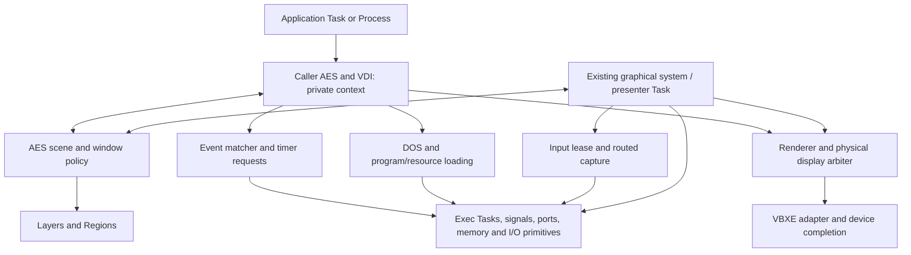

# Mapping MagiC's architecture to Exec816

[Standalone MagiC model](magic.md) · [Architecture index](README.md) ·
[Source and mapping evidence](../development/magic-exec-mapping.json)

The original inventory maps the pinned Atari MagiC model onto Exec816 revision
`4fd56448`. The ownership/service sections below now include the delivered
[native semaphore foundation](../history/native-semaphores.md) and
[MagiC-led AES migration](../history/aes-magic-migration.md). Their execution
records distinguish current behavior from the original inventory; the original
mapping evidence remains pinned. The standalone model describes MagiC itself.

## Governing port direction

The [GEM architecture guidance](../contributing/README.md#gem-architecture-guidance)
sets the target: port MagiC's GUI structure and flow onto existing Exec platform
services, using GEM4XE as the primary graphics code quarry. This applies to the
whole GUI, not just UPDATE ownership. Architectural departures require a concrete
reason and an explicit user decision before implementation. Report missing
platform capabilities instead of building GUI-specific replacements.

The user subsequently selected replacing the combined presenter with MagiC's
SCRENMGR role. The [migration plan](../plans/gem4xe/screnmgr-migration-plan.md)
assigns caller drawing, manager interaction and independent input/device progress;
execution placement remains to be resolved. Existing presenter roles below are
inventory, not the selected target or a reason to retain the combined loop.

The existing implementations, diagrams and service mappings below are inventory.
They do not endorse preserving every current Exec GUI boundary. Honor prior
explicit user decisions, while reviewing differences against the pinned MagiC
source. The original mapping evidence remains historical; current reference
contracts continue to describe implemented behavior until migration slices land.

## Architectural fit

MagiC's GEM responsibilities fit above Exec's existing execution, communication,
memory, I/O and application-lifetime services. Its tree/object/primitive/device
hierarchy is useful independently of its embedded scheduler and Atari trap
environment. The present Exec implementation already combines caller-context
AES/VDI work with one graphical system loop in the existing presenter Task.
That combined loop is a current implementation fact to review against MagiC's
execution roles, rather than a required porting boundary.

The inspected MagiC paths use direct pointers and resident shared state. Exec
also shares one address space, so this mapping does not require an IPC boundary
around every object helper or a serialization format for every internal call.

For the covered GEM responsibilities, this analysis identifies no requirement
for a second scheduler, another interrupt-input stack or a new private kernel
operation. It does identify substantial adaptations in preemption/shared state,
message semantics, lifecycle and UI policy. This is an architectural conclusion
from the inspected contracts and implementation, not a performance measurement.

The most useful decomposition is MagiC's APPL record. Its saved execution belongs
to an Exec Task; its process association belongs to Process/DOS lifetime; its
menu, window, input and event state belongs to an AES application context. Those
roles are already represented separately here. Preserving that split avoids
importing a second execution model together with otherwise reusable GUI policy.

## Foundations that can be reused

Reuse platform mechanisms while following MagiC's GUI responsibilities and flow.
The availability of an existing GUI subsystem is not a reason to retain a
different architecture. Routine ABI/addressing adaptations remain subject to
the agreed native contracts; they do not import MagiC's embedded OS underneath
Exec or make GEM4XE's original multitasking assumptions authoritative.

The distinction between kernel primitives and resident libraries matters here.
An ordinary library call can run in its caller, including when the library is
resident. Neither an AES operation nor a graphics primitive inherently requires
a kernel entry or a request to a GUI worker.

| MagiC responsibility | Reusable Exec foundation | Existing integration and remaining responsibility |
| --- | --- | --- |
| APPL execution and context switching | `Task`, task admission, saved context, `Wait`, `Signal` and `Yield` | AES registration/context is attached to an existing Task. Keep GUI identity, focus and scheduling identity separate. |
| DOS process/basepage role | `PROCESS`, per-Task DOS contexts, inherited handles/directory and loaded `Image` ownership | Use a Process for program/DOS lifetime. Plain system Tasks need no synthetic Process merely to perform AES work. Shared-process APPL threads require a separate design. |
| Application and control messages | Exec FIFO ports, stable Message records and signals | Existing AES copies eight GEM words into destination-owned records, then uses `PutMsg`. Payload copying, capacity, GUI coalescing and retirement stay in AES. |
| Keyboard, pointer and deferred event capture | Public `INPUT` leases, routes, retained notifications and native IRQ/NMI publication | The existing presenter consumes physical input. AES translates/routes it and publishes durable client state; applications do not install another BIOS input handler. |
| Event matching and combined waits | `Wait` over owned signal masks, AES input/message state and `ExecAESWait` | Reuse the current caller-side matcher. It can combine GUI/timer readiness with child/I/O notifications without consuming someone else's completion records. |
| Timers and timeout wakeups | `timer.device`, asynchronous device requests and monotonic deadlines | Existing AES timed waits use one retained alarm when needed. The timer driver needs no worker Task; preserve abort/collection and rate conversion. |
| Memory and list storage | `AllocMem`, `FreeMem`, `AvailMem`, `EXECLISTS` and upper RAM | Reuse allocation and list operations. AES still owns its object lifetimes and synchronization. Task removal is not a heap-allocation group free. |
| File access, directory scans and resource loading | Native DOS, filesystem/SIO services and existing caller-side resource/scan bindings | Keep file waits in application/loading contexts. Reuse RSC byte-order, pointer and bitmap conversion rather than importing Atari DOS calls. |
| Executable loading and launch | Native C program loader, resident provider imports, Process start/collect and image retention | APP ABI 36 already supplies normal C entry and shared services. This is rebuilt source compatibility; Atari executables and trap layouts are a different contract. |
| Screen-manager execution | Existing Task/event services and reusable menu/gesture helpers | Replace the combined AESSYSTEM/presenter loop with the selected SCRENMGR role; ordinary operations draw in their callers. Resolve independent input/device progress and execution placement explicitly. |
| UPDATE, MCTRL and scene access | Public native `SignalSemaphore`, `AESLOCKS`, `AESGATE` and short publication guards | One native resource arbitrates UPDATE/MCTRL/handler scopes. Scene access and retained physical readiness remain separate; hints never grant ownership. |
| Window visibility, overlap and damage | `LAYERS` and `REGIONS` ordinary libraries, used with one serialized shared scene | Reuse geometry and damage operations below AES window policy. AES and the scene refer to one authoritative window record set. |
| Workstation and object drawing | Current private C workstation/context, prepared object data and ordinary renderer calls | Keep tree/layout and workstation state separate from shared device scratch. MagiC can guide the call structure without replacing these foundations. |
| Physical screen access and device execution | `DISPLAY` lifetime ownership/delegated access and the VBXE driver | Reuse serialized hardware access, completion, scratch/VRAM discipline and fault retention. They are below GEM's semantic drawing operations. |
| Terminal/console behavior | Console instances, streams, copied console views and the loaded GEM Terminal | Reuse the text model and input bindings. Terminal painting uses normal AES/VDI; it does not require restoring a second native window manager. |

Authoritative interfaces: [Tasks](../reference/tasks.md),
[signals](../reference/signals.md), [ports](../reference/ports.md),
[device I/O](../reference/device-io.md), [timer](../reference/timer.md),
[memory](../reference/memory.md), [lists](../reference/lists.md),
[Processes](../reference/process.md), [DOS](../reference/dos.md),
[C images](../reference/c-program-loading.md), [input](../reference/input.md),
[Layers](../reference/layers.md), [display](../reference/display.md),
[AES](../reference/aes.md) and [console views](../reference/console-views.md).

Useful existing implementation seams include
[`aes-local.c`](../../c/calypsi/aes-local.c) / [`aeslocal.act`](../../lib/aes/aeslocal.act),
[`aes-events.c`](../../c/calypsi/aes-events.c),
[`aes-messages.c`](../../c/calypsi/aes-messages.c),
[`aesgate.act`](../history/screnmgr-migration.md#sm3d-single-update-ownership-cutover),
[`aeslocks.act`](../../lib/aes/aeslocks.act),
[`aessystem.act`](https://github.com/mkur/exec816-public/blob/a768c4f4/lib/aes/aessystem.act),
[`display-access.inc`](../../lib/display/display-access.inc) and
[`gem-vbxe.c`](../../ports/gem4xe/adapter/gem-vbxe.c).
These are existing implementations, not a claim that every interface between
them is already general or minimal.

## Execution and responsibility map



This diagram groups existing roles. It proposes no additional worker or new
kernel dispatch layer. A caller can calculate object geometry, match events,
read resources and perform eligible metadata work on its own stack. Shared
scene access is serialized separately; physical continuation/input work uses
the existing system Task. Driver entry and IRQ completion follow their own
documented protocols.

The AES system Task, native device workers and application Tasks are all Exec
Tasks. Window records, virtual workstations, ports, timers and console instances
are objects with independent lifetimes; creating another one does not inherently
justify another execution context.

## Current deviations to review

This initial inventory identifies review work, not new architectural decisions.
Development checks establish implemented behavior; they do not prove that a
departure is necessary. Cite existing explicit user approvals where they exist,
and obtain a user decision before introducing or deliberately retaining a
different architecture in the port.

| Area | MagiC baseline | Current Exec difference | Review required |
| --- | --- | --- | --- |
| Scene admission | `_wind_set` enters UPDATE and dispatches its handler. | SM3a–d assign copied reads/lifetimes and live scene operations, then remove AESGATE and the turn-wide claim. UPDATE is the sole live UI resource. | Preserve the complete owner inventory; a second gate requires a new justified decision. |
| Input and screen manager | Scheduler-side deferred key delivery is separate from `SCRENMGR` UI work. | Independent input.device capture and copied application delivery are installed. The selected frontend still combines UI, console paint, cache maintenance and device retirement. | SM4 must replace the combined frontend loop using the selected execution map; do not add Tasks/queues by default. |
| Simple frame setters | A changed slider updates and calls `wind_draw` before releasing UPDATE. | All four slider fields and title/info text now paint synchronously in the caller. | Continue the [SCRENMGR migration](../plans/gem4xe/screnmgr-migration-plan.md) with the manager event loop; reintroducing deferred caller completion needs a specific reason and a user decision. |
| Paint and cache protocols | Ordinary GEM drawing/UPDATE paths define the application contract. | EU4 removes application paint journals, completion reports and backing-cache preservation; MGVIEW uses ordinary UPDATE and VDI calls. | Keep standard redraw/copy flow; system-owned background/menu saves remain operation-owned. See the [cutover record](../history/gem-end-update-implementation.md#eu4--standard-gem-application-painting-replaces-the-journal). |
| Modal forms | The inspected modal loop retains MCTRL routing across event waits. | Current forms use an ordinary window and UPDATE for painting; desktop-wide modal ownership is unsupported. | Treat this as a semantic gap to port or an explicitly agreed limitation, rather than assuming current behavior is the target. |
| Drawing boundaries | Tree/object/primitive/device boundaries define operations; capacity drains need not transfer ownership. | Existing strip/turn budgets, continuation checks and cache work add boundaries. | Inspect MagiC and GEM4XE first. Justify any different boundary with actual device limits, measured coordination cost and peer progress. |

Source baselines are in the [standalone MagiC model](magic.md), especially its
[drawing sequence](magic.md#drawing-sequence) and
[input/event path](magic.md#input-events-and-application-messages), and the
[operation-boundary analysis](../history/magic-operation-boundaries.md).
Current implementations include [`AESLOCKS`](../../lib/aes/aeslocks.act),
[`AESSYSTEM`](https://github.com/mkur/exec816-public/blob/a768c4f4/lib/aes/aessystem.act),
[`AESWINDOW`](../../lib/aes/aeswindow.act),
[`AESWINDOWSTATE`](../../lib/aes/aeswindowstate.act) and
[`DESKPAINT`](../../lib/desktop/deskpaint.act).

The [UPDATE and scene-access audit](magic-update-scene-audit.md) traces the
key → UPDATE → setter → draw path and inventories its mutable state, live
readers and retained device effects. It confirms the second admission boundary
and deferred setter painting, but the latest saved AP2 scrolls reach neither
the native acquisition-miss nor scene-wait signal site. Existing Exec mechanisms
cover the audited path; no new platform service is demonstrated. The audit
proposes small migration slices without adopting a new gate or Task topology.
Bring remaining departures to the user before implementation.

## Reported platform-service gaps

Report a demonstrated missing capability before implementation. Include the
required semantics, relevant MagiC path, public Exec APIs considered, why they
are insufficient and the general service that would be needed. Any service
proposal must include its lifetime/failure rules, IRQ/NMI and preemption effects,
ABI impact and reserved bank-zero costs, separating measured values from estimates.
Do not implement a GUI-specific substitute or add a general service without the
user's direction. GEM event/window policy remains AES's responsibility.

Existing published limitations expose at least these gaps for full MagiC
lifecycle parity; their platform-service design and scope remain for discussion:

| Capability | Current Exec contract | Port consequence |
| --- | --- | --- |
| Forced application teardown with owned-resource recovery | Native semaphores have no foreign-owner release or owner-death recovery. Removal is barred while a Task owns or awaits a semaphore; current GUI/Process stop is cooperative. | Full MagiC termination behavior needs coordinated general lifetime/resource support, or an explicitly agreed limitation. Do not emulate recovery by editing kernel ownership from AES. |
| Automatic reclamation of process-associated heap allocations | `AllocMem`/`FreeMem` exist, but arbitrary allocations require explicit release; automatic `tc_MemEntry` reclamation is deferred. | Matching MagiC's process-associated memory cleanup needs a general allocation-lifetime facility, or an explicitly agreed limitation. Do not add an AES-private replacement allocator. |

The user reviewed these gaps on 2026-11-15. General heap reclamation is not a
prerequisite for the current C application: hosted C runtime RELEASE already
reclaims remaining tracked `malloc` allocations, and GEMDOS `Malloc` uses that
path. Keep the current runtime; revisit a general service only for a concrete
uncovered requirement. Forced teardown remains unsupported and is needed for
unresponsive-application termination, not the current cooperative drawing and
shutdown path. See the [runtime lifetime contract](../reference/c-runtime.md).

See [native semaphores](../reference/semaphores.md),
[Tasks](../reference/tasks.md), [Process lifetime](../reference/process.md) and
the cleanup comparison below. This is not an exhaustive platform-gap audit.
The scene-gate discussion has not established a missing Exec primitive:
native semaphores, signals and short publication guards already exist.

## Mismatches that require adaptation

These sections describe the current mapping and its constraints. The choice of
an adaptation must follow the governing port direction and user-decision rule.

### Preemption and ambient graphics state

The inspected Atari MagiC timer avoids suspending an application interrupted in
supervisor mode. Ordinary trap code consequently has a different preemption
environment from Exec's caller-context C/Action! libraries. MagiC also explicitly
schedules from waits and AES returns, so even its source does not establish that
all global state is safely held across every complete API call.

Exec must retain normal Task preemption and its IRQ/NMI context protocol.
`Forbid` excludes Task scheduling, permits interrupts, and a blocking `Wait`
can still let another Task run before restoring the caller's nesting. It is
unsuitable as the lifetime of a redraw, modal form or UPDATE session.

Existing per-Task parameter arrays, prepared object state and workstation state
can be reused. Shared clipping arrays, staging, command lists, cursor saves and
device state still need explicit ownership. A pure calculation can use caller
state outside physical access; shared device-state mutation belongs inside an
admitted drawing unit. Preemption alone does not release a held display grant.

**Consequence:** extract MagiC's semantic hierarchy while making state lifetime
and handoff explicit. Neither a whole-tree physical grant nor a smaller fixed
strip follows automatically from that hierarchy. Command-list capacity can cause
an internal drain without ending the semantic operation or transferring access.
Measure ownership and responsiveness before changing those boundaries.

### Three different kinds of ownership

The current implementation already separates the following roles:

| Role | Purpose | Waiting and completion rule |
| --- | --- | --- |
| UPDATE / MCTRL | Logical application painting and mouse/gesture policy | Can span calls and CPU handoffs; native FIFO ownership, with MCTRL's routing overlay on UPDATE |
| Scene gate / Layers transaction | Serialize geometry, visibility, routing publication and damage metadata | Drop the scene gate before physical work, route/resource operations or renderer callbacks; event waits hold no Layers transaction |
| Display access / device operation | Protect renderer scratch, cursor saves, DMA and hardware state | Retire dependent hardware and scratch use before release; a trusted borrowed drawing callback cannot wait for an event or issue AES RPC |

The display's retained lifetime owner is another association: it can delegate
physical units while retaining responsibility for shutdown and hardware recovery.
A VDI workstation identifies attributes/target state, not any of these ownership
roles. Distinct responsibilities do not require distinct admission gates. In
particular, the current scene gate is a deviation to review, not an established
need for a second lock beside MagiC's UPDATE. Physical scratch and asynchronous
device lifetimes must still be protected through the platform's mechanisms.

The current system can dispatch published input and device completion while
scene-dependent continuation work is deferred. Ordinary key delivery also runs
outside UPDATE, matching MagiC's `handle_key`/`write_key` event path. The presenter
acquires UPDATE at pending menu/gesture, paint, cache-transfer and console-control
operations, then releases at their settled boundaries. A retained effect can keep
ownership until its existing scene/hardware dependency retires. Readiness hints
never replace actual native acquisition. A synchronous driver fence is a bounded hardware
completion operation under physical ownership; an application event or file
wait is a different kind of blocking operation.

### UPDATE and modal semantics already differ

In MagiC, `BEG_MCTRL` acquires the recursive UPDATE blockage and additionally
saves/replaces menu and input routing. The final UPDATE release publishes the
oldest waiter's ownership before signaling its event.

The original Exec inventory used independent update/mouse holds, an implicit
mouse owner on UPDATE, and an AES eligibility/retry queue. AM1–AM4 replaced that
structure: MCTRL and window/menu handlers use one native UPDATE semaphore;
ordinary UPDATE does not redirect input. The kernel hands FIFO ownership to a
waiter before Ready. GUI depth and window-scope facts do not arbitrate ownership.
Short scene access and backend grants remain distinct from UPDATE.

The difference also reaches forms. MagiC's inspected modal form loop retains
mouse-control coordination across event waits. Current Exec forms use an owned
or temporary ordinary window and acquire UPDATE for painting. Desktop-wide modal
ownership is unsupported. This modal difference remains after the
[AES migration](../plans/gem4xe/aes-semaphore-migration-plan.md). Exec also retains
normal preemption, independent presenter input/fence work and cooperative-only
owner cleanup. A MCTRL capture-readiness wait follows native acquisition;
retained effects and wake hints cannot transfer the native resource.

### Signals, queues and copied messages

Exec signals are coalescing notification bits. They cannot replace the APPL's
backing event/message state or encode one durable occurrence per post. Keep
input records, redraw facts, queued messages and timer completion state above
the wake bit. Publish interest before the last readiness check; retain early
notifications and recheck after waking.

Exec ports enqueue caller-supplied Message references. MagiC's ordinary
`appl_write` copies bytes and allows the sender to reuse its source buffer.
The current AES destination-owned record pool is the required semantic adapter:
copy, publish through `PutMsg`, then recycle after reception. Passing an
application's temporary eight-word buffer directly as an Exec message would
change both layout and lifetime semantics.

Similarly, `ExecAESWait` can observe caller-owned completion bits, but leaves
external ports and child/I/O collection to their owners. A GUI event loop must
not consume a Process or device reply merely because its wake bit was selected.
MagiC's memory-attached message extension is not implemented by the current
ordinary eight-word AES delivery contract.

Input qualifiers/buttons, loss handling and timer resolution also follow the
current native/AES contracts. Reusing their delivery and wait machinery does
not establish exact Atari input or timing equivalence. Keep those behavioral
differences explicit when extending the supported GEM subset.

### Process cleanup and asynchronous users

MagiC records process-associated memory ownership and has application/thread,
signal and termination machinery. Exec Process cleanup closes its documented DOS
objects and retains image ownership through retirement/collection; arbitrary
heap blocks still require explicit release. `RemTask` is not an application
resource collector. A Task lease also does not retain every port, callback,
signal or buffer reachable from that Task.

Reuse the current loaded-application wrapper: attach/register AES before entry,
detach and settle GUI/resource/timer users on return, then perform DOS cleanup
and Process retirement. If teardown cannot complete, it retains the Task/image;
it does not force an unsafe unload. `RequestStop`/BREAK are cooperative.

**Consequence:** retain explicit retirement of input routes, message publishers,
windows, timers, renderer references and callback/image users. GUI identity or
Task-slot reuse must not revive stale ownership. MagiC-style forced termination,
shared-process threads and execution of asynchronous signal-handler callbacks
have no automatic one-for-one mapping to this Process/Task contract. Native
signal bits do not supply POSIX-style signal-handler execution.

### Callback and re-entry contracts

MagiC's USERDEF objects, extended forms, menu extensions and frame callbacks add
arbitrary or indirect execution edges. Current Exec object drawing supports
linked trusted renderer callbacks; application drawing callbacks, indirect
object specifications and recursive forms are outside the supported contract.
The C binding's `busy` state deliberately rejects a second public operation
on the same occupied context, while private helpers reuse the admitted context.

Copying MagiC callback placement into a physical drawing callback would allow
code to wait, make an RPC or re-enter a non-reentrant renderer with shared scratch
live. Future callback support needs a deliberate calling-context, nesting,
ownership and code-lifetime protocol. It cannot be inferred from the availability
of C function pointers or a loaded image. Retaining current unsupported behavior
does not block restructuring the built-in object path.

### Geometry, workstations and platform representations

`LAYERS` is reusable for visibility/damage, but its bounded opaque rectangles,
half-open coordinates and in-screen geometry do not implement every MagiC window
or raster convention. Keep conversion and window/frame policy in AES. A separate
translated window manager must not create another authoritative stacking or
geometry model beside the existing scene/window records.

The same applies to the device boundary. MagiC's Atari screen/offscreen functions
cannot be treated as implementations of packed VBXE pixels, command staging or
MEMAC mapping. Reuse the existing backend, list/work limits, dependency fences,
timeout recovery and reset-required ownership retention. Their completion and
IRQ/NMI rules remain in the driver/adapter, rather than becoming AES-private
kernel services.

GEM source records and resource formats also differ from native bindings.
Exec's Action! pointers occupy three bytes; the C profile uses huge-data pointers
and explicit bridges. Standard RSC words/longs are big endian. Existing resource
loading performs byte-order, address and planar-image conversion. Reusing public
interfaces and those converters avoids accidental structure casts, Atari trap
assumptions and repeated pointer validation through each layer. Live storage
and correct API use remain caller responsibilities after admission.

### Capacity and scheduling assumptions

The standard map has twelve public Tasks including root/services, plus private
idle. AES separately permits four registered clients, eight context bindings and
six windows; Layers permits eight opaque layers plus a permanent background.
These are different capacities.
A waiting Task retains its stack/DP slot. A small admitted ordinary worker pool
reserves 1,600 bank-zero bytes, including its DP and guards; a large pool reserves
2,848. The standard pools already exist and cannot grow dynamically.

Reuse the existing system Task and ordinary caller contexts. Per-window,
per-workstation, per-message or per-timer Tasks would consume scarce execution
storage without following the ownership model of those objects. Current Exec
Task priorities do not affect scheduler selection, so MagiC scheduling/priority
behavior cannot be assumed even when application-level behavior is similar.

Source authority for these counts is the [Task capacity](task-capacity.md)
guide, [AES ABI](../../abi/aes-server.json), [Layers ABI](../../abi/layers.json)
and [C image ABI](../../abi/c-program.json). Some narrative summaries, including
the DOS reference's C ABI label, still describe smaller maps or older ABIs.
Their numerical summaries were not used as current capacity/version authority
for this analysis.

## What belongs where

| Responsibility | Architectural home |
| --- | --- |
| Scheduling, context preservation, signal/port publication, generic memory and I/O primitives | Existing Exec kernel and public bindings |
| Process/DOS/image lifetime, deadlines, input acquisition, console models and display arbitration | Existing resident libraries, services and platform adapters |
| GEM IDs, copied messages, event matching, UPDATE/MCTRL, focus, windows, menus, forms, resources and workstation semantics | AES/VDI libraries and the existing graphical system Task |
| Visibility/damage geometry | Layers/Regions under AES's serialized scene ownership |
| VBXE mapping, list construction/submission, device dependencies, quiescence and fault retention | Renderer/backend and device adapter, using public coordination primitives |

The original inventory had no public native semaphore. NS0–NS5 delivered
exclusive recursive Task-owned `SignalSemaphore`, native signalless waits and
FIFO owner-before-Ready handoff. AES now uses that general public service.
Its 12-byte upper-memory object fits within the space released by AES's retired
queue/client fields, without added bank-zero reservation. Shared-mode semaphores
and forced owner-death recovery remain unsupported. Device/scene protocols are
separate; this migration does not replace every private driver protocol.

Keep ordinary pure helpers as direct calls. Preserve the existing selective
caller/system split: loading and application event waits can block in their
callers, while the system Task continues routing input and retiring physical
work. A monolithic AES server performing synchronous application file waits
would introduce head-of-line blocking even though Exec itself remains preemptive.
Existing private continuation and scene protocols still need explicit migration
if their structure changes; this analysis does not declare them replaced.

## Implications for subsequent structural work

Use the MagiC hierarchy to identify five existing roles: application context,
window/scene state, semantic redraw operation, workstation and physical device
access. These are analysis roles, not a proposal to allocate five new records.
Map the current call chain and state lifetime against them before changing code.

Preserve caller-private preparation, direct internal calls and one authoritative
scene. Keep semantic drawing progress separate from list drains, physical grants
and CPU handoffs. Establish resource/operation inputs at the appropriate entry;
retain synchronization and ordinary operational errors without introducing
repeated validation wrappers. Change one complete path at a time using existing
GEM callers and backend facilities.

Acceptance of a later change requires correct clipped pixels, durable events,
safe callbacks/lifetimes, bounded completion and cleanup. Compare total work,
ownership transitions, CPU, input responsiveness and peer progress, along with
code/heap/stack and fixed/per-Task bank-zero costs. Fewer calls, fewer grants or
a shorter source file alone would not establish a better implementation.

## Evidence and validation scope

The source record identifies the standalone MagiC model and pins current Exec
contracts, ABI inputs and selected implementation files. Observations about
existing behavior are separate from recommendations and unsupported features.
The checker revalidates the MagiC evidence, the recorded Exec input hashes,
selected structural markers, ABI facts and local links:

```sh
python3 tools/check_magic_exec_mapping.py --fetch
```

This is documentation-tier analysis, with no new emitted-code, emulator,
performance or hosted qualification run. No kernel, ABI, runtime, worker or demo
is changed. Fixed, root/kernel, every public Task and idle reserved bank-zero
deltas are **0 bytes**, including guards, alignment and unused capacity. Upper
RAM and VRAM reservation deltas are also zero.
