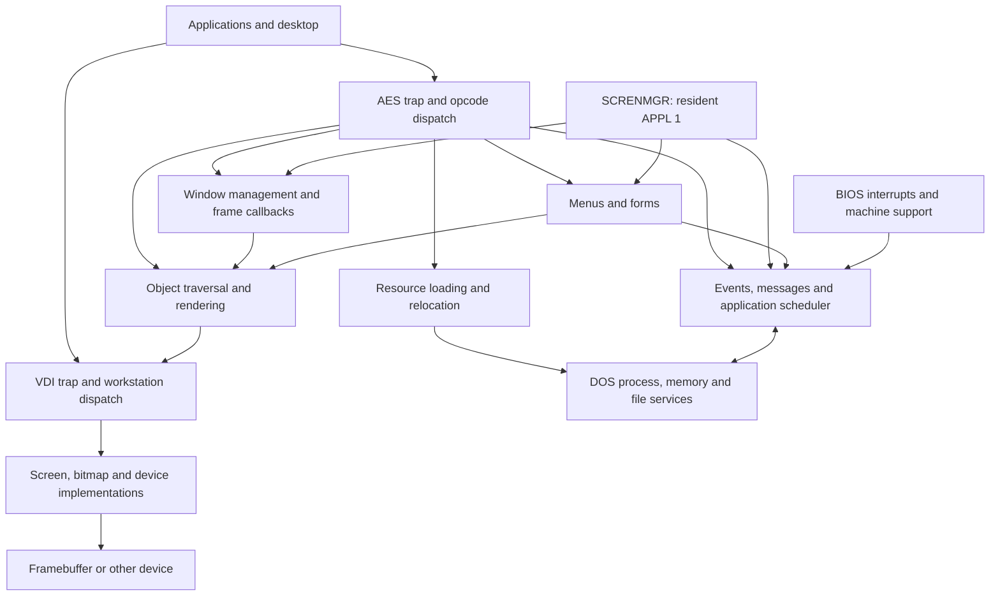
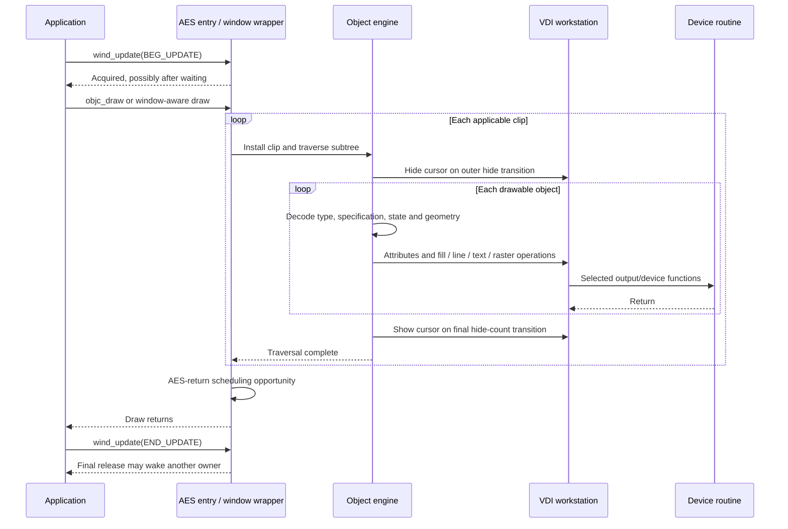
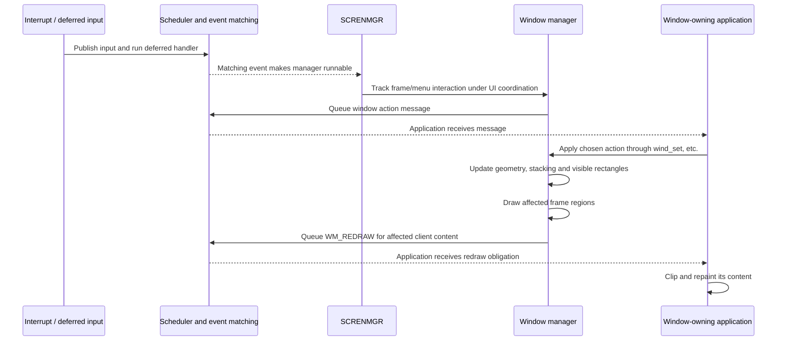

# MagiC architecture: Atari source model

This model describes the Atari MagiC source at revision
`28cfdd29aa16fef692cc287bad3046b44ddcce3d`. It covers the resident AES,
its application/event scheduler, window/menu/form/object/resource machinery,
and the common VDI/workstation/device path. BIOS and DOS appear where they
establish execution contexts, deliver events or provide process and file services.
The model describes implemented relationships; its boxes group responsibilities
and do not imply independently scheduled services or isolated address spaces.

The [source record](../development/magic-architecture.json) pins the inspected
files, selected ranges and structural checks. Routine and field names below are
source locators. The record uses physical lines after normalizing CRLF/CR to LF;
the source bytes retain their original hashes. Platform alternatives and
conditional branches are identified where they affect interpretation.

## Components and dependencies



The arrows show principal calls and event delivery. Several components also
access resident shared data defined in `AESINC.S` and `KERNEL.INC`; the actual
implementation is more interconnected than a strict layered stack.

| Component | Implemented responsibility | Main source |
| --- | --- | --- |
| Applications and desktop | Supply object trees and menus, handle messages, draw window contents and choose application actions | Client-facing dispatch in [AESMAIN] |
| AES entry and application lifecycle | Decode parameter blocks, dispatch opcodes, initialize execution records, switch active UI application and clean up departing applications | [AESMAIN] |
| Scheduler and event machinery | Save/restore application execution, maintain runnable/waiting lists, collect deferred input/I/O events, match waits and buffer messages | [AESEVT], structures in [KERNEL] |
| Screen manager | Run the resident `SCRENMGR` event loop, track menu/window interactions and route UI actions | `screnmgr` in [AESMAIN] |
| Window manager | Maintain window records, stacking and visible rectangle lists; draw frames; generate redraw and gesture messages | [AESWIN] |
| Menus and forms | Track selections, buttons, editing and modal interactions using object trees and event waits | [AESMEN], [AESFRM], graphics helpers in [AESGRAF] |
| Object engine | Traverse trees, decode object specifications and states, calculate geometry and issue drawing operations | [AESOBJ] |
| Resource manager | Load files, allocate their storage, relocate references, convert geometry and expose resource addresses | [AESRSC]; colour-image support in [FARBICON] |
| VDI core | Resolve handles/opcodes, retain workstation attributes and select output/device implementations | [DISP], [CONTROL], [ATTRIBUT], [MXVDIKNL] |
| VDI device implementations | Implement raster storage, drawing and device-specific setup/reset through function tables | [DRIVERS], [MFA2], [OFF002] |
| DOS and BIOS | Provide process descriptors, memory/file operations, machine initialization and interrupt entry | [MAGIDOS], [MALLOC], [MAGIBIOS] |

The desktop's menu/background role is represented through application fields
such as `ap_menutree` and `ap_desktree`. It is distinct from the resident screen
manager and the window manager's shared records. [KERNEL], [AESMAIN]

## Execution identities and entry points

An **APPL** is the execution record scheduled by this machinery. It contains an
application ID, status, event masks, keyboard/message storage, UI registrations
and saved supervisor-stack pointer. Its `ap_pd` links to a DOS process descriptor
or is null for an execution context without a process. `ap_type` distinguishes
main threads, threads and signal-handler contexts. Thus a process, an APPL and
a public AES application ID are related identities with different roles.
[KERNEL], [AESEVT]

`init_APPL` constructs the record, assigns its table slot and prepares its
context. `appl_init` obtains the current `act_appl` and fills the caller's AES
`global[]` information. Application creation has already happened by this point.
The scheduler restores CPU/FPU state, user/supervisor stacks and, for a process
context, `act_pd` and the termination vector. [AESMAIN], [AESEVT]

The currently executing APPL also differs from the UI targets. `menu_app`,
`keyb_app` and `topwind_app` identify menu ownership and input routing; the
window stack and `button_grect` help select the recipient. A context switch does
not, by itself, make the new CPU owner the foreground UI application.
`_set_topwind_app` explicitly updates keyboard/mouse routing. [AESMAIN], [AESINC]

### Ordinary calls

AES uses `trap #2` with selector `$C8`. `aes_trap2` routes it to `trap_aesfn`,
which calls `aes_dispatcher` synchronously. The dispatcher obtains the six
parameter-block pointers: control, global, integer input/output and address
input/output. It selects a relative opcode-table entry or the installed absolute
extension table. On the ordinary return path, `appl_yield` offers a scheduling
transition before the trap returns. Calls that wait can schedule earlier inside
the handler. [AESEVT], [AESMAIN]

VDI uses the same trap number with selector `$73`. The AES trap router forwards
unhandled selectors through its previous-vector chain. In the inspected VDI
dispatcher, the parameter block supplies the handle and opcode; the handle
selects a workstation and its dispatcher, then the opcode selects the operation.
Applications can call VDI directly, and AES object helpers call it through their
own parameter arrays. The external trap chain can contain other installed hooks.
[AESEVT], [AESOBJ], [DISP]

### Resident screen manager

AES startup creates application 0 from the BIOS-provided `app0` record and
application 1 with entry `screnmgr`, named `SCRENMGR.LOC`. The latter has no DOS
basepage in this initialization path. Its loop waits for keyboard, button,
mouse-rectangle and message events, obtains UPDATE for screen-manager work,
handles the interaction and returns to waiting. It is a real scheduled execution
context. Ordinary AES drawing calls continue to execute through the caller's
trap context. [AESMAIN]

## State ownership and lifetime

Here, ownership means a recorded association or responsibility for use and
cleanup. It does not imply that a pointer is private or inaccessible elsewhere.

| State | Association and lifetime | Significant boundary |
| --- | --- | --- |
| DOS process descriptor/basepage | Process state; APPLs can refer to it through `ap_pd` | Scheduler updates `act_pd` when restoring a process context |
| APPL and saved execution | Allocated/initialized for a scheduled context; contains its wait and queue state | Initialization, blocking/resumption and application/thread departure |
| Runnable, waiting and suspended lists | Resident scheduler state, linked through APPL records | `appl_yield`, event matching and explicit suspension |
| Application AES parameter arrays | Supplied by the caller, including resource bindings in `global[]` | Call return, or the whole blocked call while its data remains referenced |
| Window record | AES allocation with `w_owner` pointing at an APPL; geometry, flags, frame tree and rectangle lists are persistent | Create allocates; open/close changes visibility; delete releases a closed owned record |
| Window visible rectangles | AES-managed `WGRECT` lists derived from geometry and stacking | Rebuilt as windows change; FIRST/NEXT queries expose the visible regions |
| OBJECT/TEDINFO/image/string storage | Supplied by applications or a loaded resource block; pointers are used directly and data can be modified | Drawing/editing use, registration lifetime, resource free or owner cleanup |
| Registered menu/background | APPL stores tree pointers; resident globals select the active tree/owner | Register, switch active application, withdraw and exit |
| Loaded resource block | `rsrc_load` allocates it and records resource/tree addresses in the caller's `global[]` | Relocation precedes use; `rsrc_free` clears the block binding and frees storage |
| AES drawing scratch | Resident `vdipb`, `vcontrl`, `vintin`, point/output arrays and current clip | Reused by internal helpers; save/reload requirements are routine-specific |
| VDI workstation | Handle-table entry with attributes, clip, target organization and function pointers | Open/default initialization through close/reset/free |
| Driver/font/buffer state | Some state is shared across workstations; workstation records can refer to common fonts, buffers and device implementations | Driver loading/reference use and workstation/device shutdown |
| Cursor state | AES has nested `moff_cnt`; APPL records also retain local mouse state; VDI has device cursor state and saved background | Nested hide/show, application mouse-state changes and device cursor drawing |

Source layouts and lifecycle operations: [KERNEL], [AESINC], [AESMAIN],
[AESWIN], [AESRSC], [CONTROL], [NVDIWK], [INPUT], [DRIVERS].

Separate workstation handles retain separate drawing attributes while targeting
the same screen. A workstation handle does not itself reserve exclusive screen
access. AES also maintains its own drawing parameter arrays and current clip;
these are not automatically a private copy of every workstation's state.
[AESINC], [DISP], [CONTROL]

Resource relocation and menu installation demonstrate that object trees are
live mutable structures: `rsc_init` fixes references and geometry, and `menu_on`
can adjust title/menu positions. Storing a tree pointer is a continuing
relationship with that storage, not a snapshot of its pixels. [AESRSC], [AESMEN]

## Drawing sequence

The following is the ordinary built-in object path with a caller-managed UPDATE
session. Window-aware drawing adds visible-rectangle intersections; plain
`objc_draw` uses the supplied clip and does not enumerate a window's visibility
on its own. [AESWIN], [AESOBJ]



`objc_wdraw` intersects the requested area with screen/work bounds as appropriate
and walks the window's `w_wg` list. Each nonempty intersection installs a clip and
invokes the object traversal. Frame-tree drawing has a distinct work-area clipping
case. The clip loop can therefore repeat traversal. [AESWIN]

`_objc_draw` keeps parent coordinates and depth on its call frame. Hidden subtrees
and the requested depth affect traversal. `__objc_draw` turns one object into
its body, border, text/image and state effects. One object may issue several VDI
operations. AES's nested mouse counter prevents an inner helper from showing the
pointer before the enclosing drawing operation finishes. [AESOBJ]

VDI preserves semantic operations: polyline processes segments, text delegates
to workstation text output, and raster operations clip/normalize their geometry
before calling functions such as `p_bitblt` and `p_expblt`. Rectangle fill reaches
the selected fill implementation. The inspected monochrome offscreen driver
includes CPU store loops. Its row iterations are implementation work within an
operation, without an automatic scheduler handoff at each row. [OUTPUT],
[RASTER], [MFA2], [OFF002]

`G_USERDEF` adds an application callback to this graph. `do_userdef` constructs a
`PARMBLK` with object state, geometry, clip and user parameter, then calls
`ub_code` synchronously. This is an explicit extension boundary; a built-in-only
call graph does not establish what arbitrary callback code does. [AESOBJ]

## Input, events and application messages

Interrupt input and application-visible event delivery have separate stages.
`mov_int`, `but_int` and timer handling record state and queue deferred handlers
in a bounded ring. `read_evnts_from_ringbuf`, reached by the scheduler, drains
those handlers and processes pending I/O completions. Overflow handling includes
specific recovery flags; the ring is not an unlimited event history. [AESEVT]

Each APPL has requested/arrived event masks plus backing state such as its
keyboard and message buffers. `event_happened` records an event and moves an
eligible waiter toward the ready list. `_evnt_multi` checks existing conditions,
registers remaining waits and can call `appl_wait`; the latter enters WAITING and
invokes the scheduler. Resumption continues the same call frame. Input capture,
readiness, selection for CPU execution and API return are separate transitions.
[AESEVT], [KERNEL]

Ordinary `appl_write` copies message bytes into the destination APPL's buffer
and handles a destination already waiting for a message. Internal `send_msg`
constructs the usual eight-word message and calls that path. MagiC also has an
extended write mode that can transfer ownership of attached memory; it is
separate from copying an ordinary message. [AESEVT]

Window interaction connects the screen-manager and caller paths:



This is the common request/response pattern, not a universal promise that every
gesture waits for a client decision. `wind_was_clicked` has special cases for
activation and window state. `wind_redraw` separately redraws the frame and sends
a client redraw message; `send_redraw_message` clips the requested content area
against the work area and visible-region coverage. Moving a window can copy
existing screen pixels and redraw uncovered portions. [AESMAIN], [AESWIN]

## Menus, forms and resources

**Menus.** `menu_on` records the application's tree, chooses the active menu owner,
can adjust layout, draws the menu and reinitializes the screen manager's watched
region. `do_menu` can dispatch an installed submenu implementation through
`xmenu_info`; its resident fallback uses an event-driven state machine. Ordinary
application menu selections are delivered as messages. Registration, active menu
selection and an interaction in progress have different lifetimes.
[AESMEN], [AESMAIN]

**Forms.** `form_do` enters `_form_xdo` with ordinary defaults. The operation
retains its tree/editing state on the call frame, obtains mouse-control
coordination, and repeatedly waits for input, changes object/edit state and
redraws affected parts until an exit condition. Waiting schedules other APPLs
while the form call remains active. Extended forms can invoke an application
callback through `__fdo_callback`; window-aware form helpers also exist. These
paths should not all be treated as one identical modal protocol. [AESFRM]

**Resources.** `rsrc_load` finds and opens a file through DOS, allocates a block,
reads it and calls `rsc_init`. The initializer writes resource/tree bindings into
the caller's AES global array and fixes object/resource references and geometry.
`rsrc_gaddr` returns addresses into those structures. `rsrc_rcfix` dispatches to
the same initializer for caller-supplied storage. `rsrc_free` frees the bound
block; addresses into it depend on that block remaining live. Load failures
close the file and release any newly allocated block. [AESRSC], [AESMAIN]

The legacy file selector in `AESFSL.S` combines an object tree, form/graphics
helpers and DOS directory/file operations. The separate extended selector and
window-dialog implementations are additional paths outside this detailed trace.
[AESFSL]

## Coordination and scheduling

| Mechanism | What the inspected implementation coordinates | Distinction |
| --- | --- | --- |
| UPDATE `BLOCKAGE` | Recursive owner/count and waiter list; contenders can wait on `EV_SEM` | Logical screen-update ownership can span several calls and CPU handoffs |
| Final UPDATE release | Select the oldest waiter, publish its ownership and event, then offer scheduling | Publishing the next owner and selecting the next CPU context are separate steps |
| Mouse control (`BEG_MCTRL`) | Acquires UPDATE and saves/replaces menu/input routing for the controlling APPL; nesting is counted | Adds UI routing control to UPDATE; it does not suspend all other applications |
| `inaes` | Scheduler entry guard set by `appl_yield` and cleared on its return | Its presence is not evidence of a lock covering every complete AES handler |
| `no_switch` | A scheduler gate checked before changing contexts | Distinct from UPDATE ownership and interrupt masking |
| Atari timer gate | On slice expiry, inspect saved SR and skip timer-driven application suspension when interrupted in supervisor mode | Interrupt delivery can still occur; explicit wait/yield paths remain possible |
| Short SR masking | Protect selected interrupt-shared operations, including ring/cursor state | Local interrupt exclusion has a different extent from an API operation |
| VDI operation return | Return from the selected workstation/device implementation | No automatic per-primitive screen-ownership transfer is established by the dispatcher |

Sources: [AESEVT] (`appl_yield`, `ad_switch`, `wind_update`, `free_semaphore`,
`beg_mctrl`), [MAGIBIOS] (`i200_yield`), [INPUT], [DISP].

The Atari timer rule is central to interpreting shared AES scratch and ordinary
trap execution. It does not prohibit every switch during a supervisor-mode call:
blocking AES operations explicitly invoke the scheduler. Routine-specific saved
state, logical locks and callback behavior still matter. No universal duration
budget follows from the size of an AES or VDI call.

## VDI and extension boundaries

`alloc_wk` reserves a handle and workstation allocation; `wk_defaults` installs
attributes, clipping and implementation pointers. `v_opnvwk` creates another
workstation against an existing device. Close/reset paths release workstation
storage and adjust driver use. The workstation layout also contains raster
organization and font/buffer references, so it is more than a table of colours.
[CONTROL], [NVDIWK]

The device boundary is indirect: workstation output pointers and loaded
screen/offscreen implementations supply drawing and raster functions.
`DRIVERS.C` selects compatible offscreen organizations and loads/unloads their
implementations. The selected monochrome CPU path is one implementation of
that boundary. Completion behavior of an arbitrary accelerated or external
driver cannot be inferred from its CPU store loops. [DRIVERS], [MFA2], [OFF002]

Extensions also exist above VDI. The window manager calls `wbm_*` frame callbacks,
AES dispatch supports an absolute extension table, and object/form rendering can
call application functions. These are implemented dependency edges, not holes to
fill with an assumed closed call graph. [AESINC], [AESWIN], [AESMAIN], [AESOBJ],
[AESFRM]

## Initialization and departure

The BIOS path initializes machine support, DOS and VDI facilities. AES startup
initializes its APPL table, creates application 0 and `SCRENMGR`, processes
configuration, opens its graphics workstation and obtains screen storage before
the later application-loading work. The selected source contains alternate and
conditional startup paths; this sequence describes the inspected resident Atari
path rather than proving a particular release's complete boot execution.
[MAGIBIOS], [AESMAIN], [AESOBJ]

UI departure is also explicit. `appl_end_mctrl` unwinds owned mouse-control
routing. The broader `wind_new` path withdraws menus/backgrounds/windows,
releases owned UPDATE/semaphore state, resets mouse state and discards messages.
Other lifecycle routines publish termination
notifications and remove execution records. DOS memory ownership and process
termination are related cleanup domains, rather than consequences of merely
closing a window. This model does not enumerate every thread/signal/error exit.
[AESMAIN], [AESEVT], [MALLOC]

## Structural properties and evidence limits

The implemented structure separates application execution, UI focus, logical
screen coordination, object/resource storage, workstation attributes and device
execution. Window allocation differs from visibility; message publication differs
from scheduling; object drawing differs from device-loop iteration. Synchronous
API calls coexist with a scheduled screen manager and deferred input delivery.
Shared globals and indirect callbacks connect these responsibilities.

This is a static source model. The source checks validate pinned bytes, selected
ranges, structural markers and documentation links. They do not reconstruct an
exhaustive call graph, establish source/release-binary equivalence or measure
timing. BIOS/DOS and desktop-program internals, external VDI trap hooks, all
window-frame libraries, network/filesystem implementations, MagiCMac/Milan and
every optional extension
remain outside the detailed model. Selected ordinary paths are identified;
untraced alternatives are not assigned invented ownership or completion rules.

Recheck the evidence, downloading missing pinned files when necessary:

```sh
python3 tools/check_magic_architecture.py --fetch
```

[AESINC]: https://gitlab.com/AndreasK/Atari-Mac-MagiC-Sources/-/blob/28cfdd29aa16fef692cc287bad3046b44ddcce3d/MagiC/KERNEL/AES/SRC/AESINC.S
[AESMAIN]: https://gitlab.com/AndreasK/Atari-Mac-MagiC-Sources/-/blob/28cfdd29aa16fef692cc287bad3046b44ddcce3d/MagiC/KERNEL/AES/SRC/AESMAIN.S
[AESEVT]: https://gitlab.com/AndreasK/Atari-Mac-MagiC-Sources/-/blob/28cfdd29aa16fef692cc287bad3046b44ddcce3d/MagiC/KERNEL/AES/SRC/AESEVT.S
[AESWIN]: https://gitlab.com/AndreasK/Atari-Mac-MagiC-Sources/-/blob/28cfdd29aa16fef692cc287bad3046b44ddcce3d/MagiC/KERNEL/AES/SRC/AESWIN.S
[AESOBJ]: https://gitlab.com/AndreasK/Atari-Mac-MagiC-Sources/-/blob/28cfdd29aa16fef692cc287bad3046b44ddcce3d/MagiC/KERNEL/AES/SRC/AESOBJ.S
[AESFRM]: https://gitlab.com/AndreasK/Atari-Mac-MagiC-Sources/-/blob/28cfdd29aa16fef692cc287bad3046b44ddcce3d/MagiC/KERNEL/AES/SRC/AESFRM.S
[AESGRAF]: https://gitlab.com/AndreasK/Atari-Mac-MagiC-Sources/-/blob/28cfdd29aa16fef692cc287bad3046b44ddcce3d/MagiC/KERNEL/AES/SRC/AESGRAF.S
[AESMEN]: https://gitlab.com/AndreasK/Atari-Mac-MagiC-Sources/-/blob/28cfdd29aa16fef692cc287bad3046b44ddcce3d/MagiC/KERNEL/AES/SRC/AESMEN.S
[AESRSC]: https://gitlab.com/AndreasK/Atari-Mac-MagiC-Sources/-/blob/28cfdd29aa16fef692cc287bad3046b44ddcce3d/MagiC/KERNEL/AES/SRC/AESRSC.S
[AESFSL]: https://gitlab.com/AndreasK/Atari-Mac-MagiC-Sources/-/blob/28cfdd29aa16fef692cc287bad3046b44ddcce3d/MagiC/KERNEL/AES/SRC/AESFSL.S
[FARBICON]: https://gitlab.com/AndreasK/Atari-Mac-MagiC-Sources/-/blob/28cfdd29aa16fef692cc287bad3046b44ddcce3d/MagiC/KERNEL/AES/SRC/FARBICON.S
[DISP]: https://gitlab.com/AndreasK/Atari-Mac-MagiC-Sources/-/blob/28cfdd29aa16fef692cc287bad3046b44ddcce3d/MagiC/KERNEL/VDI/SRC/MAGICVDI.2/DISP.S
[OUTPUT]: https://gitlab.com/AndreasK/Atari-Mac-MagiC-Sources/-/blob/28cfdd29aa16fef692cc287bad3046b44ddcce3d/MagiC/KERNEL/VDI/SRC/MAGICVDI.2/OUTPUT.S
[RASTER]: https://gitlab.com/AndreasK/Atari-Mac-MagiC-Sources/-/blob/28cfdd29aa16fef692cc287bad3046b44ddcce3d/MagiC/KERNEL/VDI/SRC/MAGICVDI.2/RASTER.S
[INPUT]: https://gitlab.com/AndreasK/Atari-Mac-MagiC-Sources/-/blob/28cfdd29aa16fef692cc287bad3046b44ddcce3d/MagiC/KERNEL/VDI/SRC/MAGICVDI.2/INPUT.S
[CONTROL]: https://gitlab.com/AndreasK/Atari-Mac-MagiC-Sources/-/blob/28cfdd29aa16fef692cc287bad3046b44ddcce3d/MagiC/KERNEL/VDI/SRC/MAGICVDI.2/CONTROL.S
[ATTRIBUT]: https://gitlab.com/AndreasK/Atari-Mac-MagiC-Sources/-/blob/28cfdd29aa16fef692cc287bad3046b44ddcce3d/MagiC/KERNEL/VDI/SRC/MAGICVDI.2/ATTRIBUT.S
[MXVDIKNL]: https://gitlab.com/AndreasK/Atari-Mac-MagiC-Sources/-/blob/28cfdd29aa16fef692cc287bad3046b44ddcce3d/MagiC/KERNEL/VDI/SRC/MAGICVDI.2/MXVDIKNL.S
[DRIVERS]: https://gitlab.com/AndreasK/Atari-Mac-MagiC-Sources/-/blob/28cfdd29aa16fef692cc287bad3046b44ddcce3d/MagiC/KERNEL/VDI/SRC/MAGICVDI.2/DRIVERS.C
[NVDIWK]: https://gitlab.com/AndreasK/Atari-Mac-MagiC-Sources/-/blob/28cfdd29aa16fef692cc287bad3046b44ddcce3d/MagiC/KERNEL/VDI/SRC/MAGICVDI.2/NVDI_WK.H
[MAGIBIOS]: https://gitlab.com/AndreasK/Atari-Mac-MagiC-Sources/-/blob/28cfdd29aa16fef692cc287bad3046b44ddcce3d/MagiC/KERNEL/BIOS/ATARI/MAGIBIOS.S
[MAGIDOS]: https://gitlab.com/AndreasK/Atari-Mac-MagiC-Sources/-/blob/28cfdd29aa16fef692cc287bad3046b44ddcce3d/MagiC/KERNEL/DOS/MAGIDOS.S
[MALLOC]: https://gitlab.com/AndreasK/Atari-Mac-MagiC-Sources/-/blob/28cfdd29aa16fef692cc287bad3046b44ddcce3d/MagiC/KERNEL/DOS/MALLOC.S
[MFA2]: https://gitlab.com/AndreasK/Atari-Mac-MagiC-Sources/-/blob/28cfdd29aa16fef692cc287bad3046b44ddcce3d/MagiC/KERNEL/VDI/SRC/MAGIC.DRV/MFA/MFA2.S
[OFF002]: https://gitlab.com/AndreasK/Atari-Mac-MagiC-Sources/-/blob/28cfdd29aa16fef692cc287bad3046b44ddcce3d/MagiC/KERNEL/VDI/SRC/MAGIC.DRV/OSD/OFF002.S
[KERNEL]: https://gitlab.com/AndreasK/Atari-Mac-MagiC-Sources/-/blob/28cfdd29aa16fef692cc287bad3046b44ddcce3d/MagiC/KERNEL/INC/KERNEL.INC
