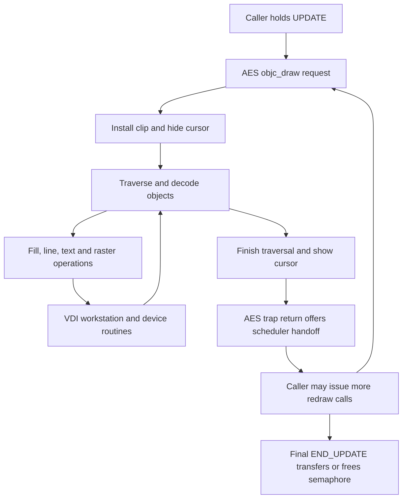

# MagiC drawing and scheduling boundaries

[History](README.md) · [Shared-source comparison](atari-st-reference.md) ·
[Source evidence](../development/magic-operation-boundaries.json) ·
[Current display contract](../reference/display.md#delegated-renderer-access)

MagiC gives drawing a hierarchy of operations: a redraw session, clipped tree
traversals, individual objects, VDI operations and device routines. These are
different from opportunities to switch Tasks or hand over shared graphics
state. The inspected Atari timer path excludes supervisor-mode execution from
timer-driven Task switching; the AES trap offers a scheduler handoff after
dispatch returns. A VDI primitive return is therefore not automatically a
scheduling or renderer-ownership boundary.

For Exec816, the main finding is that a blitter-list budget does not bound the
entire display grant. Several lists, object effects and overlay repairs can run
inside one grant. GF14 rejected its larger-strip trial; it did not establish
that the retained 16/32-row policy is optimal. Smaller grants remain a hypothesis
to measure, independently of MagiC's different scheduling architecture.

## Scope and source identity

This is source analysis of MagiC revision
`28cfdd29aa16fef692cc287bad3046b44ddcce3d`, the revision in the existing
[ST reference pin](../../toolchain/atari-st-reference.json). The evidence records
raw SHA-256 hashes, source URLs, selected routine locations and the Exec816
comparison revision. Downloads and the analysis script are retained under
`build/magic-operation-boundaries/`. Text inspection normalizes CRLF/CR to LF;
hashes cover unchanged source bytes.

The scheduling conclusion is specific to the Atari BIOS path and the ordinary
built-in object path. It is not a claim about MagiCMac/Milan, every external VDI
hook, arbitrary USERDEF callbacks, or every screen driver's hardware completion.
The previous Hatari measurements remain historical evidence. No new emulator
run, timing distribution or source-to-release-binary equivalence is established
here.

| Source at the pinned revision | Inspected responsibility |
| --- | --- |
| [AESOBJ.S](https://gitlab.com/AndreasK/Atari-Mac-MagiC-Sources/-/blob/28cfdd29aa16fef692cc287bad3046b44ddcce3d/MagiC/KERNEL/AES/SRC/AESOBJ.S) | Object traversal, primitive wrappers and nested cursor hiding |
| [AESWIN.S](https://gitlab.com/AndreasK/Atari-Mac-MagiC-Sources/-/blob/28cfdd29aa16fef692cc287bad3046b44ddcce3d/MagiC/KERNEL/AES/SRC/AESWIN.S) | Window rectangle-list drawing |
| [AESMAIN.S](https://gitlab.com/AndreasK/Atari-Mac-MagiC-Sources/-/blob/28cfdd29aa16fef692cc287bad3046b44ddcce3d/MagiC/KERNEL/AES/SRC/AESMAIN.S) | AES opcode dispatch and objc_draw admission |
| [AESEVT.S](https://gitlab.com/AndreasK/Atari-Mac-MagiC-Sources/-/blob/28cfdd29aa16fef692cc287bad3046b44ddcce3d/MagiC/KERNEL/AES/SRC/AESEVT.S) | AES trap return, scheduler and UPDATE semaphore |
| [MAGIBIOS.S, Atari](https://gitlab.com/AndreasK/Atari-Mac-MagiC-Sources/-/blob/28cfdd29aa16fef692cc287bad3046b44ddcce3d/MagiC/KERNEL/BIOS/ATARI/MAGIBIOS.S) | Timer-driven preemption gate |
| [DISP.S](https://gitlab.com/AndreasK/Atari-Mac-MagiC-Sources/-/blob/28cfdd29aa16fef692cc287bad3046b44ddcce3d/MagiC/KERNEL/VDI/SRC/MAGICVDI.2/DISP.S), [OUTPUT.S](https://gitlab.com/AndreasK/Atari-Mac-MagiC-Sources/-/blob/28cfdd29aa16fef692cc287bad3046b44ddcce3d/MagiC/KERNEL/VDI/SRC/MAGICVDI.2/OUTPUT.S), [RASTER.S](https://gitlab.com/AndreasK/Atari-Mac-MagiC-Sources/-/blob/28cfdd29aa16fef692cc287bad3046b44ddcce3d/MagiC/KERNEL/VDI/SRC/MAGICVDI.2/RASTER.S) | Workstation dispatch, output operations and clipped raster calls |
| [INPUT.S](https://gitlab.com/AndreasK/Atari-Mac-MagiC-Sources/-/blob/28cfdd29aa16fef692cc287bad3046b44ddcce3d/MagiC/KERNEL/VDI/SRC/MAGICVDI.2/INPUT.S), [MFA2.S](https://gitlab.com/AndreasK/Atari-Mac-MagiC-Sources/-/blob/28cfdd29aa16fef692cc287bad3046b44ddcce3d/MagiC/KERNEL/VDI/SRC/MAGIC.DRV/MFA/MFA2.S), [OFF002.S](https://gitlab.com/AndreasK/Atari-Mac-MagiC-Sources/-/blob/28cfdd29aa16fef692cc287bad3046b44ddcce3d/MagiC/KERNEL/VDI/SRC/MAGIC.DRV/OSD/OFF002.S) | Cursor operations and a monochrome CPU drawing path |

## Boundaries in the MagiC path

| Boundary | What finishes or changes | What it does not establish |
| --- | --- | --- |
| BEG_UPDATE to final END_UPDATE | Caller owns the logical screen-update semaphore across a redraw session | Continuous CPU execution, one physical transaction or atomic scanout |
| One visible rectangle | Window-aware drawing intersects a rectangle, installs its clip and invokes tree drawing | A scheduler handoff after that rectangle |
| One objc_draw request | Traverses the selected subtree under its clip, with nested cursor hide/show around traversal | A fixed row, pixel, work or elapsed-time limit |
| One built-in object | Decodes state and emits the object's fill, border, text, image and effects | One VDI call or one constant-cost unit |
| One VDI operation | Dispatches an opcode through its workstation to output/device routines | Release of a separate display grant, or a Task switch |
| A device loop iteration | Performs part of a line, rectangle, glyph or raster operation | An application-visible continuation or handoff |
| AES trap return or explicit wait/yield | Offers a scheduler transition, subject to scheduler state and runnable work | Transfer of UPDATE ownership unless the semaphore is released |

For the ordinary built-in drawing request, the relevant call structure is:

Window-aware drawing adds a visible-rectangle loop around tree drawing. The
standard application FIRST/NEXT redraw loop can instead supply the clips.
Neither route creates an Exec-style lease for each pixel strip.

## Drawing operations and state lifetime

In AESOBJ, the entry establishes clipping and the internal traversal carries
parent coordinates. Each visited object reaches the object renderer; hidden
subtrees and depth limits affect traversal. The selected tree draw brackets its
work with cursor hide/show. Nested bitmap helpers use the same hide counter,
so an inner helper does not restore the cursor while the outer traversal still
holds it hidden. USERDEF dispatch calls application code and is outside the
built-in-path scheduling conclusion.

AESWIN's window-aware wrapper walks the window's rectangle list, intersects
each rectangle with the requested region and relevant work/screen bounds, sets
the clip, and invokes tree drawing. Consequently, clipping fragments can cause
repeated traversal. They are geometric boundaries rather than automatic
ownership transfers.

The common VDI dispatcher selects a workstation and operation, calls the
function and returns through its epilogue. Attribute operations share that
dispatch mechanism with drawing operations. The dispatcher has no counterpart
to Exec816's delegated display admission and release around every object strip.

The output layer preserves semantic operations rather than imposing a common
row height. A thin polyline walks its segments before returning. Text delegates
to the workstation's text routine. Rectangle fill passes the supplied rectangle
to the fill path; BAR can add perimeter work. Thus even one VDI operation can
contain several lower-level actions. AES wrappers can issue attribute calls
before an output call, and an object's border or state effects can add more
operations.

Raster calls normalize and clip source/destination geometry, then invoke the
appropriate workstation copy/expansion routine. A mask/data composite must not
be assumed to be a single hardware operation merely because it belongs to one
icon. Driver selection and completion rules remain below that API boundary.

The inspected two-colour screen driver obtains its offscreen implementation
through the loader. OFF002 supplies a CPU fill path with a height-derived row
counter, word/longword stores and a final return. Those stores finish before
that path returns; its row loop contains no automatic Task handoff. This does
not prove which function pointers the retained release selected at runtime or
establish the completion protocol of unrelated accelerated drivers.

## Scheduling, UPDATE and interrupt distinctions

The Atari BIOS timer updates its clock and expires the configured time-slice
counter. Before invoking application suspension, it tests the saved status
register and skips suspension when the interrupted code was in supervisor mode.
Ordinary AES/VDI trap execution therefore has a different preemption environment
from Exec816's preemptible caller-context renderer. The source does not provide
a universal millisecond budget for an object, tree or VDI call.

AESEVT's AES trap calls the dispatcher and subsequently the scheduler. Other
trap operations, including nested VDI calls, are forwarded rather than taking
that AES-return path. Scheduler re-entry and switching have their own gates.
Blocking AES operations may also wait explicitly inside dispatch; API-call size
alone cannot describe every scheduling opportunity.
The downstream forwarded trap chain and all installed extensions were not
exhaustively traced. These findings do not prove that an indirect callback or
hook can never yield inside a drawing operation.

UPDATE is separately recursive and contended acquisition can wait. Final
release selects the oldest waiter, publishes its ownership/readiness, then
invokes the scheduler. An application can retain UPDATE across several calls
while other applications receive CPU time. UPDATE is therefore not equivalent
to disabling Task switching for its entire lifetime.

Interrupt delivery, capturing input, dispatching application events and drawing
the cursor are separate stages. Cursor hiding does not itself stop interrupts.
The VDI cursor code also has short status-register masking around coordinate
updates; this is distinct from the timer's supervisor-mode scheduling test.
None of these source observations establishes end-to-end input latency.

## Comparison with current Exec816

The comparison uses Exec816 revision `627affc7`, after GF15. The evidence hashes
the inspected Exec sources; current contracts remain authoritative.

| Exec boundary | Current behavior | Consequence for granularity |
| --- | --- | --- |
| [Object traversal](../../c/calypsi/aes-objects.c) | Prepares a description once per object; uses 32-row callbacks for complete extents up to 32 rows, otherwise 16-row strips | Preparation is already separate from repeated shared-state painting |
| [Public VDI painting](../../c/calypsi/vdi.c) | Clips visibility and delegates units; solid fills use a width/work-derived row capacity | Object strip height is not the only unit policy |
| [Physical borrow](../../ports/gem4xe/adapter/gem-vbxe.c) | Enter, erase intersecting pointer, paint callback, fence, restore overlays/cursor, final fence, Leave | One grant includes setup, paint, completion and overlay work |
| Blitter list drain in that adapter | Submits and resets a bounded command list without leaving the display grant | 64 records / 8,192 estimated accesses bound each list, not all work under one grant |
| [Display arbitration](../../lib/display/display-access.inc) | FIFO admission and short state guards; drawing retains ordinary Task preemption | Off-Task time can extend ownership while peers need the renderer |

The hierarchy of one Exec object draw is therefore: prepared object, visible
intersection, physical strip grant, primitive calls, one or more bounded device
lists. A list may finish while the callback still needs shared GSX arrays,
redirection, scratch or overlay state. Inserting Leave into a list drain would
require a valid continuation and restored state before painting resumed.
The borrow helper adds no Forbid/Permit pair; caller-supplied nesting remains
governed by the existing display contract.

The MagiC comparison supports direct calls, stable preparation and meaningful
operation boundaries. It does not establish that its primitive returns transfer
the screen to another Task, or that its scheduling gate should be copied.
The earlier [Forbid experiment](drawing-preemption.md) was removed at the user's
request; this analysis does not restore or propose it. Normal Exec preemption,
FIFO admission, fences, IRQ/NMI coordination and fault retention remain the
requirements.

## Consequences for the next experiment

The [GF14 decision](gem-first-gui.md#gf14-drawing-boundary-decision) remains a
rejection of one 32-row candidate, not proof that current units are optimal.
Row count alone omits width, object effects, glyph/raster work, overlay repairs,
multiple submissions and time preempted while ownership remains held.

Start with one fixture-only **8-row cap**, including objects currently eligible
for a 32-row callback. Preserve prepared descriptions and compare against the
frozen GF15 implementation. This is an Exec-specific experiment, not a MagiC
constant. Keep the existing list budgets and all coordination semantics.

Compare exact settled pixels and cleanup first, then total caller/presenter CPU,
grant/submission counts and complete ownership duration, separating CPU,
interrupts and off-Task time. Include pointer overlap, text/icons, wide and nested
objects, fragmented exposure and disk/input peer progress. Distinguish input
capture, event delivery and visible completion. Smaller grants may improve
access latency while increasing repeated arbitration, cursor and fence work;
neither direction is assumed to win. A row cap alone cannot guarantee an
ownership wall-time limit while its owner remains preemptible.

Observe arbitration publication/handoff where possible. Enter-return through
Leave-entry is a lower bound on ownership; Enter-entry through Leave-return
also includes possible admission waiting and bookkeeping. Keep those brackets
distinct from the actual ownership interval.

If the measurements justify a structural change, examine resumable fill, line,
text and raster groups next. A group must retire dependent hardware work and
leave shared scratch and overlays in a state safe for another renderer. Such a
change needs its own implementation slice; the source comparison supplies no
permission to yield inside an unfinished mask/copy sequence or change kernel
scheduling policy.

## Validation and resource impact

Documentation-tier checks verify the pinned downloads, raw source hashes,
selected labels and call-order/gate observations, the comparison source hashes,
and local document links. The source evidence includes the checks and selected
ranges so the findings can be rechecked without relying on translated comments
or source-browser line normalization. It is not an exhaustive call-graph audit.

No target code, ABI, compiler pin or demo package changes. Fixed/root/kernel,
every public Task and private idle add **0 reserved bank-zero bytes**, including
guards, alignment and unused capacity. Upper RAM and VRAM deltas are zero.
No new emitted-code, emulator, latency, hosted-release or hardware qualification
is claimed. The existing GF14/GF15 records retain their original scope.
