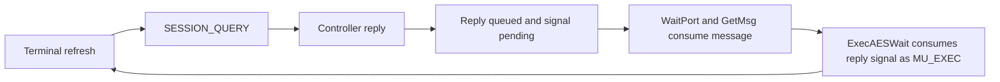

# Viewer wait and wake audit

[History](README.md) · [Evidence](../development/viewer-wait-audit.json) ·
[Input-copy measurements](input-snapshot-copy.md) ·
[Drawing baseline](gui-drawing-baseline.md) · [Exec signals](../reference/signals.md)

## Finding

The packaged Terminal creates a feedback loop between its synchronous session
query and its external AES wake. Its reply port and console-view subscription
share one signal bit. A reply already queued when `WaitPort` runs leaves that
bit pending. The following `ExecAESWait` consumes it as a view notification and
returns `MU_EXEC`; Terminal immediately refreshes and queries the controller
again, even though its cells and paint count have not changed.



This is a confirmed source of unnecessary background work while the viewer is
ready to run. No runtime fix was applied and no latency improvement from a fix
has been measured. The root controller sleeps normally between requests; no
controller retry-yield path was captured in the measured windows.

## Source and emitted-code chain

[TerminalPlatformOpen](../../examples/gem-terminal/platform.c) sets `app->wake`
from `app->replies->mp_SigBit`. Refresh unconditionally performs a synchronous
`SESSION_QUERY`; console views subscribe with that same `app->wake`, and
`TerminalPlatformWait` passes it to `ExecAESWait`. The
[main loop](../../examples/gem-terminal/main.c) refreshes again after each wait.

[WaitPort](../../c/calypsi/exec.c) returns immediately when its queue already
contains a message. Neither that path nor `GetMsg` consumes the signal. That is
normal message-port behavior: queue contents and received signals are separate
state. The [AES event wrapper](../../c/calypsi/aes-events.c) clears pending
external signals with `SetSignal(0, externalMask)` and reports them as `MU_EXEC`.

The confirmation capture resolves Terminal from its live Process/loaded image:
slot 5, direct page `$1200`, Task address 136226, Process identity 4. Its reply
bit is `$00200000`. The root request-port bit is `$00040000` in the root Task;
signal masks are Task-local.

Across the eight timed repaint intervals, the emitted trace contains:

| Observation | Count |
| --- | ---: |
| Fully contained successful Terminal exchanges | 118 |
| Fully contained completed `ExecAESWait` calls | 118 |
| Returns of `MU_EXEC` / `MU_TIMER` | 97 / 21 |
| Exchanges with no call to blocking `Wait` | 97 |
| Event waits clearing the pending reply bit | 97 |
| Complete query/reply/no-wait/clear/`MU_EXEC` chains | 95 |
| Controller retry yields | 0 |

Two additional `MU_EXEC` decisions have preceding exchanges crossing the action
boundaries, so they are excluded from the complete-chain count. Boundary
placement also explains 119 fully contained native query-reply helper calls
versus 118 complete C exchanges. Terminal's paint count stays at 26 at all three
checkpoints, and all retained session cells have the same hash.

The [controller](../../examples/shell/shell-controller.inc) handles queries
through `ShellSessionQueryReply`. Each request also triggers its ordinary
controller turn: session collection, completion-mask lookup and
`DesktopWatch`/`DesktopService` child supervision. In idle, 117 fully contained
controller steps consume 979.9 ms of root CPU across eight actions; 360 root
`Process.Collect` calls consume 295.8 ms and 359 `Process.CompletionMask` calls
286.7 ms. These scopes are inclusive and overlap; they must not be added.
All captured completed root waits return the request-port bit, in both scenes.

## Where repaint time goes

All values below are means per completed repaint, across four page actions and
four line actions. Idle still includes the resident Terminal and desktop.
The loaded scene adds Counter and the existing native disk workload.

| Time, ms | Idle | Counter/disk |
| --- | ---: | ---: |
| Viewer CPU | 436.6 | 475.1 |
| IRQ time while viewer is selected | 95.2 | 155.5 |
| Viewer ready, off CPU | 437.5 | 975.0 |
| Viewer blocked, off CPU | 79.4 | 238.9 |
| Unclassified initial prefix | 1.6 | 3.2 |
| Total key offer to completed repaint | 1050.2 | 1847.8 |

The following peer costs are incurred only while the viewer is ready. IRQ
columns describe interrupt execution during that peer's selected intervals,
separately from its CPU work.

| Peer | Idle CPU, ms | Idle IRQ, ms | Loaded CPU, ms | Loaded IRQ, ms |
| --- | ---: | ---: | ---: | ---: |
| Terminal | 171.3 | 36.9 | 232.0 | 75.0 |
| Root controller | 128.4 | 27.7 | 171.9 | 54.1 |
| GUI worker | 60.2 | 13.0 | 81.2 | 28.9 |

Terminal and root account for 299.7 ms of peer CPU plus 64.6 ms of IRQ time in
idle, and 403.9 ms plus 129.1 ms under load. This identifies a substantial
competing workload, not an estimate of removable latency. Terminal's normal
100 ms refresh timer and legitimate controller work remain relevant.

The ready intervals also distinguish ordinary preemption from dispatch after
a blocking wait:

| Ready off-CPU time, ms | Idle | Counter/disk |
| --- | ---: | ---: |
| After preemption/rescheduling | 407.5 | 864.9 |
| After captured blocking waits | 29.0 | 110.0 |
| Initial ready episode of unknown origin | 1.1 | 0.1 |

Most ready time is CPU sharing after preemption. The captured wait-to-first-run
intervals are smaller. This supports reducing unsolicited background work
before changing normal Task preemption.

## Actual blocking

| Blocked off-CPU time, ms | Idle | Counter/disk |
| --- | ---: | ---: |
| Scene admission | 16.0 | 44.1 |
| UPDATE/window admission | 51.3 | 173.5 |
| Input/events | 12.1 | 21.4 |

These categories reconcile exactly with the blocked budget before rounding.
Wait counts include episodes overlapping each measured interval; their costs
are clipped to those intervals. The first input wait began before capture,
so its unobserved prefix stays unclassified.

The viewer's 168 `Display.Enter` calls, 21 per repaint, acquire physical grants
without a captured blocking wait. Scene and UPDATE admission do block. That
does not make physical drawing free: the matching dense capture bounds mean
hardware BUSY time at 9.76–15.18 ms in idle and 9.69–28.66 ms under load. Scene
handoffs, publication, caller preparation and drawing CPU remain in the path.

## Observer and validation

[trace_viewer_waits.py](../../tools/trace_viewer_waits.py) reuses the baseline
runner and its physical input, pixel oracle and cleanup checks. It observes
existing linked instructions for scheduler state, atomic signal/wait fields,
native controller/admission scopes and relocated Terminal C calls. Target Task
and both words of each signal mask are reconstructed from checked instruction
sites. No guest instructions or data are patched and no markers execute in the
guest. Live stopped-debugger snapshots identify Tasks and retained Terminal
state. The flat instruction profile is supplementary, not a per-Task timing
oracle.

Two observed/untraced scene pairs and an additional idle confirmation all pass
on the identical optimized OF816 package from runtime revision `067b2eff`:

- ZIP SHA-256: `0ac9643b83545a9f44639505551df5ca033375c0cfb9f8f71353929d428ac884`.
- Dedicated AltirraOS 3.44 for 65C816 ROM, SHA-256
  `85a6e927038f401f05f0056fd41a062986cbf7e104c1ac135c248764c132c9a7`;
  pinned [emulator and machine](../../toolchain/altirra-gem-vdi.json), PAL,
  8× 65816, 63 high banks, shadow ROM and VBXE FX 1.26 at `$D600`.
- Pinned [actionc revision](../../toolchain/actionc.json), optimized release
  compiler; unchanged `SYS:STORY.TXT`, 6,663 bytes/220 lines, 56 columns and
  18 visible document rows in work rectangle `[40,43,456,170]`.

Timings, counters and pixels match the original dense observations and the
untraced companions exactly after one constant scheduler-clock origin alignment
per comparison. The idle pair and confirmation require 35,568 cycles; the
loaded pair and both original dense comparisons require zero. No per-action
alignment or timing tolerance is used.

All five boots retain the 250-frame/five-second OF816 autoboot and pass exact
77,520-pixel work-area oracles at initial/page/line checkpoints, boundary no-op,
warmed heap return, stack/domain guards, ownership and EXIT. Counter progress
and persisted disk bytes pass in the loaded pair. Each repaint retains six
paint bands, seven BEGIN/END pairs, 21 grants, 23 launches, 20 text calls and
31 fences. Completed-repaint timing excludes scanout; settled pixels are
checked separately.

The host suite passes 710 tests with four existing historical-source skips.
Eight new focused tests cover atomic field decoding, signal clearing,
recipient attribution, incomplete traces and ready-interval accounting. An
initial analyzer counted repeated READY publications twice; coalescing an
already-ready episode removes 99.622 ms of duplicate attribution across the
eight idle actions. A regression covers that correction, and the final ready
and blocked totals reconcile exactly. Capture and analyzer hashes are recorded
separately; the committed observer prepares the same 1,328 PCs as the archived
confirmation observer.

This is development testing of the frozen package, not a new hosted-system or
hardware qualification. Runtime code, ABI, Tasks and guest reservations are
unchanged. Reserved bank-zero growth is **zero bytes** for fixed services,
root, kernel, idle and each public Task, including guards, alignment and unused
capacity. Upper-memory and VRAM reservation growth is also zero.

## Reproduction and next slice

```sh
python3 tools/trace_viewer_waits.py --bundle build/input-snapshot-copy/demo --output build/wait-idle --count 4 --observe
python3 tools/trace_viewer_waits.py --bundle build/input-snapshot-copy/demo --output build/wait-idle-replay --count 4
python3 tools/trace_viewer_waits.py --bundle build/input-snapshot-copy/demo --output build/wait-loaded --count 4 --load build/gui-baseline/load --observe
python3 tools/trace_viewer_waits.py --bundle build/input-snapshot-copy/demo --output build/wait-loaded-replay --count 4 --load build/gui-baseline/load
python3 -m unittest discover -s tests -p 'test_*.py'
```

Use fresh output directories. The evidence records the original capture paths,
observer versions, source hashes, exact replay comparisons and raw artifacts.
Saved observations can be reanalyzed with `--analyze-only`.

The next single implementation slice should give Terminal's console-view
notifications a separately allocated signal, distinct from its synchronous
reply port. Use existing signal allocation, subscription and AES wait APIs,
with failure/cleanup coverage. Keep the 100 ms timer and controller supervision
policy unchanged for a matched before/after comparison. Verify that successful
RPC replies no longer produce `MU_EXEC`, retain genuine view/input/timer wakes,
then compare the same idle and Counter/disk repaints. This audit does not yet
implement that slice.
