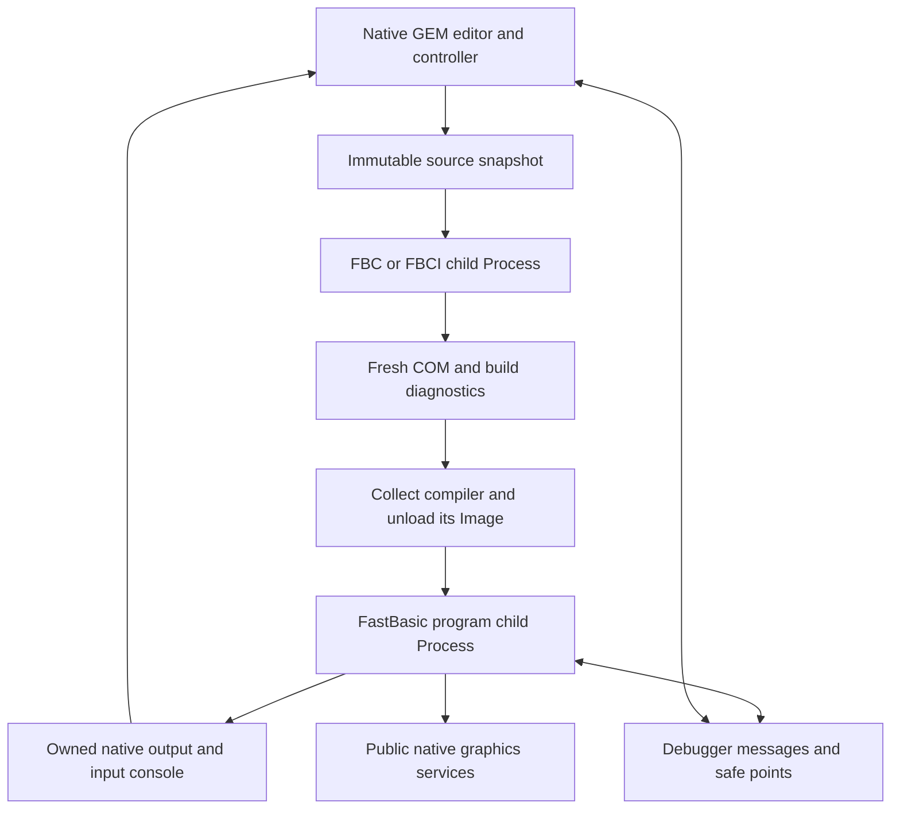

# FastBasic GEM workbench design

Status: proposed, 20 October 2026. This defines the next programming environment;
the [current FastBasic contract](../reference/fastbasic.md) continues to describe
the delivered command-line compilers and runtime.

[Implementation plan](fastbasic-workbench-implementation-plan.md) ·
[Plan index](README.md) · [GEM integration](gem4xe/README.md) ·
[Migration plan](fastbasic-6502-migration-plan.md) ·
[Floating point delivery](../history/fastbasic-floating-point.md) ·
[Platform contract](../reference/platform.md)

Build a loadable `C:BASIC.APP`: a native 65816 C application using Exec816's
hosted GEM AES/VDI interface. Keep FastBasic syntax, integer and floating-point
semantics, and the maintained compiler/runtime source port. Give the user an
integrated editor, Run/Stop, source debugging and native graphics. GFA BASIC
supplies the interaction model; source or binary compatibility with GFA is
outside this design.

The first executable delivery is **edit → Run → output → return to editor**,
including unsaved buffers, compile-error navigation and cooperative Stop.
Debugging and graphics have separate completion gates. A Run button over the
existing shell commands does not complete the full workbench.

## Architecture and ownership

The workbench owns the source document, editor state, build jobs, output console
and every compiler/program child it starts. Each FastBasic child remains an
ordinary Exec Process with a private guest bank and its existing native service
adapter. The GEM presenter retains window/input policy; drivers retain device
queueing, cancellation and retirement. No IDE policy enters the kernel.

Compilation and execution are sequential. Collect the compiler and unload its
Image before loading the program: loading an Image itself claims one of the
two shared SDX/FastBasic guest slots. The IDE consumes no guest slot. A retained
compiler must not occupy a slot for the IDE's whole lifetime.

Use classic Exec message, signal and device-I/O ownership. A sent request and
its buffers remain live until its exact reply is collected. Stop requests
cooperative cancellation; Close requests orderly shutdown. There is no forced
Task removal or unloading of an executing or paused Image.

### Existing components and required extensions

| Component | Reuse and remaining work |
| --- | --- |
| [FBC/FBCI](../reference/fastbasic.md) | Reuse both on-machine compilers, FB65 loading, files, integer/FP runtime and guest transition protocol. Add structured diagnostics and optional debug emission in the FastBasic port. |
| [Loadable C applications](../reference/c-program-loading.md) | Reuse relocation, Process startup, AES attachment and teardown. Build BASIC.APP independently of the resident desktop. |
| [GEM text viewer](gem4xe/text-viewer-design.md) | Reuse loading, window, scrolling, clipping and repaint patterns from [gem-text](../../examples/gem-text/text.c). Its document is read-only; editing and undo require a new model. Extract shared helpers only when both applications use them. |
| [Program launcher](../../c/include/exec816/program.h) | Its current implementation chooses NIL input and shell RAW output. Extend the public interface to select owned child streams, directory and cancellation binding. It is not already an interactive IDE launcher. |
| [AES events](../reference/aes.md) | Add a public way to wait for GUI readiness together with caller-owned Exec signal masks. Current `evnt_multi` does not accept child-completion/debug signals. |
| [Console windows](../reference/console-windows.md) | Reuse native cooked input, GET/KEY, retained cells and routing. General application console presentation is required: current desktop BIND_CONSOLE is restricted to the Shell controller. |
| [Resident VDI](../reference/gem-vdi.md#resident-application-workstations) | Bars, text and clipping support the editor. Lines, circles and a retained BASIC graphics surface require explicit extensions; the separate supervised renderer's polyline support is not an application VDI capability. |

Changes to loading, child streams, event waits and console presentation must be
reusable by other applications. Implement them above Exec using public kernel
primitives. No BASIC-specific COP selector, private driver operation, resident
IDE worker or extra periodic polling Task is justified.

## Application and interaction

Launch `BASIC.APP` with zero or one quoted source path through the existing
Process argument contract. With no path, show an empty document. A failed Open
leaves the committed document, cursor and undo history intact. Start on demand
from the shell or Files; preserve the demo's normal startup.
New, Open and Quit resolve a modified document through Save/Discard/Cancel
before replacing it. Cancel preserves the current document and application.

Use one resizable editor window and create one output console window when
Check/Run first needs it. Keep diagnostics and variable inspection in panes
of the editor window. Both windows count against the existing desktop limit;
hidden windows still consume slots. An unavailable Task, window, console or
guest slot produces an ordinary visible resource error and preserves the source.

Menus provide File New/Open/Save/Save As/Quit, Edit Undo/Redo/Find/Replace,
Program Check/Run/Stop/Build, and View Source/Output. Add Debug commands only
with the debugger delivery. Choose shortcuts from the actual Atari keyboard
profile; do not require PC function keys. Menu actions remain available when
a shortcut is unavailable. Display the filename, modified marker, cursor
line/column, integer/FP selection and current job state.

Run uses the current buffer without forcing a disk Save. Default new documents
to FBC, and allow explicit FBCI selection; do not infer a language mode by
searching for `%` characters. Build saves a standalone command. Source navigation,
window messages, repaint, output viewing and Stop remain usable during a child
run. The first profile makes source text read-only during compilation, execution
and pause, preserving the exact source generation associated with diagnostics.
Breakpoint changes and variable inspection remain available while paused.

Auto-indent, lexical colouring, procedure navigation and folding belong in the
native editor. Keep the compiler authoritative for syntax and semantics. Check
compiles to a disposable output using the same compiler path as Run. Lexical
colouring must not become a second BASIC parser or reject code the compiler
accepts. Folded source remains in the document and compiler input; an error or
debug stop unfolds its destination automatically.

## Document and file behavior

Use a counted upper-RAM gap buffer with a line-start index, separate viewport
and selection state, and a bounded undo/redo log. Gap movement must preserve
logical text; reindexing and bulk edits must publish coherent document state.
Keep large movement, search and loading work bounded so the event loop can
service input and painting. Measure worst-case edits before fixing chunk sizes.

The proposed first profile holds at most **32,768 normalized source bytes**,
**4,096 editable lines** and **255 bytes per line**, excluding its terminator.
These are editor limits, not a promise that every document compiles: source,
generated bytecode and parser workspace still compete inside a FastBasic bank.
The existing FBC capacity measurement is not a general language limit. Reject
an oversized load or edit without truncating the current text.

Normalize LF, CRLF, CR and ATASCII `$9B` to LF internally. Preserve a uniform
input's delimiter and final-EOL choice on Save; new files default to `$9B` for
EDX interoperability. Mark mixed-EOL normalization as a document change.
Accept printable ASCII and tabs in this initial editor; reject other source
bytes explicitly rather than silently replacing them. An empty document has
one editable empty line; a final delimiter creates an editable trailing line.

Tab display uses eight-column stops. Cursor/diagnostic locations retain byte
offsets independently of visual columns. Use horizontal viewport panning when
the caret leaves the visible columns; horizontal GEM gadgets are not a current
dependency. Obtain font/work-area metrics from GEM and preserve the logical
caret/selection across move, resize, focus and view changes.

Load a candidate in units of at most 1 KiB and commit only after successful EOF,
validation and Close. Keep 16 KiB for undo records including their metadata;
discard oldest complete groups to admit new ones. Reject an individual edit
that cannot fit that undo budget before changing the document.

Save serializes a snapshot to an exclusively created temporary file in the
destination directory, checks every transfer and terminal Close, then publishes
it by rename. For an existing target, first rename that target to an unused
backup name, then rename the completed temporary to the target. Respect native
8.3 names and same-directory rename. The
[filesystem contract](../reference/filesystem-writes.md) has no atomic replace:
retain and report recovery paths if publication fails, attempt restoration
only on a usable mount, and never delete the only known complete copy. Keep the
document modified until publication succeeds. A failed Save does not close the
editor or erase the in-memory document.
Clear the modified marker only if the published snapshot still matches the
current document generation; edits made during Save remain modified. Commit a
Save As filename only after successful publication.

Painting uses the existing visible-rectangle/UPDATE contract. Start with at most
four text rows per UPDATE section, release ownership before servicing other
events, and repaint caret/selection damage rather than the whole page. Recompute
visible rectangles after releasing UPDATE. Do not retain a drawing token across
compilation, disk I/O, debugger waits or user input.

## Compilation and Run lifecycle

Each job gets an immutable normalized source snapshot, a monotonically assigned
generation and private short names on `RAM:` for source, COM, diagnostics and
later debug metadata. Export snapshot line endings as `$9B`; map compiler byte
columns back through tabs in that exact snapshot. Private names must avoid
collisions between simultaneous IDE instances and keep quoted argument tails
within the current 255-byte Process limit.

The document's project directory starts from its named source's parent, or the
launch directory for an untitled document. Give each child an owned copy of
that directory lock. Scratch files use absolute RAM paths; they must not change
the directory used by relative BASIC file operations or an unrelated Process.

The controller follows these states:

| State | Ownership and transition |
| --- | --- |
| Editing | No live compiler/program child. Run freezes source and prepares scratch files and output resources. |
| Compiling | One compiler child owns its guest resources. Stop requests its cancellation; diagnostics and output are associated with the frozen generation. |
| Preparing execution | Collect compiler results and unload its Image. Require successful compile/output Close, then load and admit the fresh COM. Check discards it; Build publishes it using the Save rules. |
| Running | One program child owns its runtime, files and optional graphics/debug state. Normal end, fatal error and Stop proceed to collection. |
| Paused | Debugger retains a live program at a declared safe point. Continue/Step resumes it; Stop cancels it and completes normal cleanup. |
| Retiring | Collect child, debug replies, drawing and console use before freeing resources. Only then allow another Run or IDE exit. |

A failed compile/load/start never runs an earlier successful COM. Preserve the
two Process result values and the first causal I/O error. Cleanup failures must
not replace a syntax, runtime or write failure. Keep ordinary handled BASIC
`ERR()` behavior unchanged; an arithmetic ERR is not automatically a fatal IDE
error. Show the source location only when the compiler/debug metadata identifies
it, distinguishing a last-known statement from an exact fault location.

Add structured compiler diagnostics containing stage, native error, BASIC
error where applicable, source generation, line/byte column and bounded message
text. Use a versioned record from the source port; retain command-line messages.
The IDE must not parse human-readable PRINT output as its diagnostic ABI. Both
host and on-machine compilers must agree on location numbering.

Source and terminal output are separate models. The output window owns a native
console instance: PRINT/PUT go to its retained cells, INPUT uses cooked editing,
and GET/KEY retain current FastBasic meanings. Focusing the editor routes keys
to GEM; focusing output routes them to that console. No key may be consumed by
both. Stop remains available from the editor menu regardless of output focus.
Retain completed text output for inspection until the next explicit clear/run.
Set that owned console to ATASCII mode before admitting a child, so the child's
normal mode restoration preserves the output's glyph interpretation. Coordinate
changes with retired readers and input routes; never change the Shell's mode.

Use `PROCESS.RequestBreak`/Stop and ordinary retirement for running children;
do not use a debugger Pause as cancellation. Disk or device operations already
in flight must retire according to their driver contracts. Record CPU-side
BREAK observation separately from I/O and full retirement time. Synchronous
startup/file operations may delay the IDE's own next event turn; measure those
intervals, and introduce reusable resumable loading if they defeat acceptance.

Quit while a job is active enters Stop/Retiring. It cannot destroy the output
console, unload the child or return from the IDE Process early. After collection,
apply the usual unsaved-document decision and close owned windows/resources.

## Public integration interfaces

Extend the current C program-start interface with a descriptor for copied
arguments, an optional owned directory lock, owned input/output handles and
cancellation/console binding. Preserve the current NIL/shell defaults for
ordinary desktop launches through the descriptor's default values. Update all
callers and generated ABI definitions together; do not retain an old ABI profile.

The interactive child owns a cancellation scope bound to the IDE-created output
console. Its setup copies stream ownership and establishes that route before
entry. The IDE keeps its independent DOS/AES context and remains responsive;
`StartForeground`'s suspension of the parent's DOS context is unsuitable here.
This is a reusable DOS/Process operation for graphical launchers, implemented
with existing public Exec primitives. Establish ownership at admission, then
trust live caller-owned handles through the normal dispatch path.

Expose console creation/destruction and a general console-content window binding
to C applications. Restrict a caller to its owned console and window. Keep one
presentation owner: the console worker paints cells and caret, GEM/desktop paints
the frame and commits focus/routing. Retain the instance through redraw retirement;
close the binding and endpoints before Destroy. Initially retain the desktop
console's fixed 64×20 geometry; resizing the editor does not resize BASIC output.
This replaces no Shell binding and provides no access to its private state.

Add a public AES/Exec wait extension combining selected GUI events with owned
child-completion, debugger and graphics signal masks. Return readiness without
collecting another subsystem's messages. Each owner drains its exact replies
and rechecks durable state before sleeping. Preserve the existing input-epoch
and signal-race protocol. The IDE must not block in `ExecWaitProgram` or emulate
completion events with periodic timers.

New format versions, import layouts, service IDs and shared record sizes belong
in the machine-readable [FastBasic](../../abi/fastbasic.json),
[C program](../../abi/c-program.json) and relevant service ABI inputs with
generated C/Action!/assembly definitions.
Allocate them during implementation against the then-current tables. The current
FB65 profile has no debugger or graphics services. Rebuild FBC, FBCI, host tools,
runtime libraries, callers and demos together when that profile changes.

## Source debugging

Debug builds emit a separate metadata file tied to the source generation,
canonical source checksum, complete COM checksum, target identity, compiler
variant and runtime/token layout. Reject a mismatched pair before attaching.
Keep the executable envelope small; release Build omits debug metadata/hooks.
Debug output must also run without an attached debugger, with hooks continuing
normally. A release program's execution and BASIC error rules stay the same.

The compiler records source-to-bytecode statement boundaries, executable ranges,
procedure entries/exits and actual variable types/storage. Statements may emit
several bytecodes or no code; map them explicitly. Do not infer locations from
disassembly, assume one bytecode per source line, or invent local-variable scopes
the donor language does not implement. Compiler/parser changes belong in the
FastBasic port, with focused emission regressions.

Initial debugger commands are Pause, Continue, Step Into, toggle a source
breakpoint and read variables/array elements. Step Into executes from the current
stop and pauses at the next executed statement boundary, including another
statement on that line or the next iteration at the same location. Include loop
backedges so an empty busy loop has an eligible stop. A breakpoint on a line
without emitted code reports that it has no executable location rather than
silently moving. Keep Step Over, conditional breakpoints, expression watches
and mutation of paused variables for a later extension after call-depth and
evaluation semantics are defined.

Publish a stop only at compiler-declared statement boundaries with a complete
guest context and no outstanding service/drawing borrow. Keep decimal math,
hidden B, D, DBR, page-one ownership, FP state and flags intact under the existing
IRQ/NMI transition protocol. Pause requests observed at a dispatch/copy/math
checkpoint can remain pending until the next eligible statement. Pause during
blocking INPUT waits for that operation to finish; Stop can still cancel it.

Use copied command/reply records through public Exec messages. Associate every
message with the run identity and stop generation so stale Continue/inspection
requests cannot affect another run. The native session mediates guest reads;
the IDE does not follow changing interpreter pointers in a running guest.
Inspection occurs while stopped and respects the donor's counted strings,
six-byte floats, array extents and integer procedure-parameter convention.

Pausing retains the Process, Image, open BASIC files and debug buffers. It
releases UPDATE, physical display access and active I/O requests before waiting.
Step/Continue acknowledge the current stopped generation; Stop has priority and
is collected through normal Process retirement. The IDE cannot detach/free its
debug endpoint while the child may still send a reply. Do not install an ORCA,
GFA or replacement COP debugger; Exec keeps COP #$50 and the OS keeps #$00.

## Native graphics from BASIC

Add an Exec extension to the restricted FastBasic grammar while preserving
existing syntax and numeric behavior. Start with open/close, clear, colour,
filled rectangle, line, text and event input. Circle/ellipse, sprites, sound and
GUI widgets follow separately. Do not reinterpret Atari GRAPHICS mode numbers,
emulate ANTIC/GTIA or enable arbitrary external USR as an escape hatch.

Provide a reusable public native window/drawing facade above the current
desktop/renderer, with C and Action! clients as well as the FastBasic adapter.
The BASIC-facing bridge marshals counted strings, scalar coordinates and event
results across the existing guest transition. Native code owns its requests,
copied drawing content and window handles; the presenter never retains a pointer
into BASIC text, arrays or an executing guest stack. No new math/kernel service
or render Task is required.

Use one retained graphics window per BASIC invocation initially, so exposure
repair does not require a BASIC callback. Clear resets a pending frame's
background and commands; drawing appends to that bounded frame. Present validates
and publishes the complete model, while physical repaint follows the desktop's
incremental completion rules. It does not promise a tear-free frame swap. Use
window-local signed coordinates with widened clipping and the current sixteen
colour pens. Events carry window-local coordinates, translated keys, buttons and a
durable Close notice. Waits permit Stop. Define the BASIC spellings, event record,
frame capacity and overflow result in the graphics slice before enabling grammar.
Overflow must preserve the last published frame, never silently drop commands.

The existing native REPLACE payload holds only 32 fill/text commands and 256
text bytes; it does not already supply this graphics API. Extend a public
retained drawing contract for lines and practical frame sizes, with bounded
painting and documented upper-memory cost. The ordinary resident VDI subset
also lacks lines; share the renderer primitive where justified rather than
claiming the supervised polyline workload is a callable application backend.
Establish application-visible clipping and generation semantics first.

Every BASIC graphics invocation owns its windows until Close or Process return;
normal exit, error and Stop drain drawing/events and close them. A paused program
keeps its published scene visible. Keeping a graphical frame after the program
has exited requires an explicit ownership transfer and is outside the first
graphics profile. Standalone built commands use the same graphics facade and
work without BASIC.APP. Admission without the required desktop/backend reports
unsupported behavior explicitly.

## Memory and capacity

Target **0 added fixed, root/kernel, per-public-Task and idle reserved bank-zero
bytes**, including guards, alignment and unused capacity. This documentation
change itself adds **0 bytes** in all four categories. Reuse the current Task
stack/DP pools and the existing 544-byte guarded two-slot SDX/FastBasic D pool.
The native IDE leases an existing public Task slot; one sequential compiler or
program child leases another. No extra stack pool, slot or hidden worker is
budgeted. Measure the C call chains, selector nesting and bridge/interrupt
headroom before claiming the current per-Task stack capacity fits.

The proposed editor allocations are upper RAM and separate from image backing:

| Allocation | Initial capacity or accounting rule |
| --- | --- |
| Editable source | 32,768 bytes including the gap and unused capacity. |
| Line starts and sentinel | 4,097 32-bit offsets: 16,388 bytes before allocator rounding. |
| Undo/redo | 16,384 bytes total including record metadata and unused capacity. |
| Candidate Open / Run snapshot | Up to another full document/index as its lifetime requires; report simultaneous peaks, including RAM filesystem copies. |
| Native IDE Image | C profile's full bank-aligned backing, serialized snapshot, BSS and relocation/placement overhead. Read actual spans from the build. |
| Compiler or program Image | Existing 131,072-byte aligned backing plus native session, Image record, allocator-rounded file snapshot and ordinary Process/DOS/timer allocations. Compiler/program lifetimes do not overlap. |
| Output console and window | Existing retained-cell, endpoint, cooked input, route and window allocations; no private physical screen or new VRAM reservation is assumed. |
| Debug metadata / graphics scenes | Explicit upper-RAM capacities set and boundary-tested in their slices; no allocation proportional to an unbounded program run. |

Free a candidate or compiler before the next expensive phase where ownership
allows it. Report actual peak upper usage, full reserved bank-zero deltas, native
stack peaks, free Task/guest/AES/window/console slots and renderer/VRAM costs on
the selected desktop. The system's total RAM does not enlarge FastBasic's guest
address space. Under capacity pressure, refuse the job and preserve the document;
do not silently remove other applications or change the boot memory budget.

## Delivery boundaries and acceptance

1. **Native editor:** BASIC.APP loads/saves a document with selection, undo,
   search, indentation, navigation and exact text/EOL rules. Physical keyboard,
   mouse, resize, exposure, failed replacement and allocation-boundary cases
   preserve the committed model and normal desktop operation.
2. **Integrated Run:** land the reusable process, console and event-wait
   interfaces. Compile an unsaved integer and FP buffer, select a structured
   error, run only fresh output after compiler retirement, exercise INPUT/GET/KEY,
   Stop a no-I/O loop and return to the original caret. Build publishes a command
   that runs independently after the IDE exits.
3. **Debugger:** prove metadata agreement in host/on-machine builds, breakpoint
   mapping, statement stepping, paused reads, two independent sessions, stale
   request rejection, Stop while paused and full register/resource restoration.
   Measure debug overhead separately from ordinary execution.
4. **Graphics:** implement the public facade and bounded retained scene, then
   grammar/services. Compare pixels for clear/bar/line/text, clipping and
   cover/exposure; exercise input/focus, capacity, standalone execution and
   cancellation while native disk/pointer/console work continues.
5. **Packaged workbench:** clean-extract the actual GEM demo ZIP and use physical
   input for edit → Run → error → fix → debug → graphics → Build → Quit. Check
   file bytes, final images, guards, owned requests, heap/slot recovery and normal
   EXIT. Keep existing text-console FBC/FBCI development coverage.

Use the [development testing tier](../contributing/testing.md): host document/
transaction checks and focused optimized emitted execution; small raw/optimized
probes for new ABI, Action!/C and guest-bridge behavior. Run content/link checks
for this design-only change. Compiler or emulator defects belong upstream with
focused regressions, not IDE-specific workarounds. Record real latency from
input through scanout, cold/warm Run stages, cancellation observation and full
retirement on pinned ROM/emulator/media inputs. These gates do not qualify the
whole hosted platform or physical hardware.

Package through `tools/build_demo.py` with OF816, its five-second autoboot,
matching system/work disks, ROM and notices. Preserve the selected desktop and
standard shell/prime startup behavior. Include matching XEX, old/new Atarimax
CAR and raw BIN; boot ZIPs contain only boot files, a short guide, notices and
checksums. Keep source delivery separate and refresh corresponding FastBasic
sources when its compiler/runtime changes. Store implementation evidence outside
boot packages and publish supported contracts/guides only as slices land.

The native GEM editor supersedes the earlier FB7 proposal to port `editor.bas`
and Atari screen-editor services. A terminal IDE, GFA compatibility, native
65816 BASIC code generation, larger guest addresses, live editing of a running
source generation and direct-mode evaluation in a paused program remain separate
work. Ordinary shell compilation and EDX remain available through their current
interfaces.
