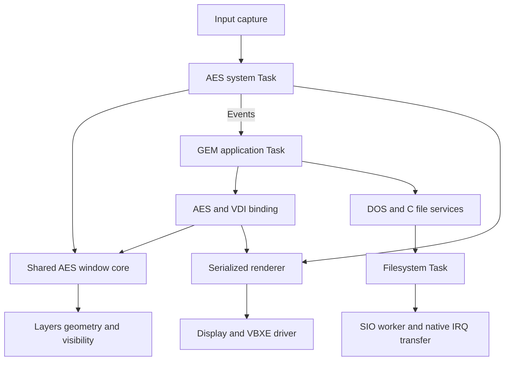

# GEM-first GUI on Exec816

[GEM plans](README.md) · [Source compatibility](gem-source-compatibility-plan.md) ·
[Current AES contract](../../reference/aes.md) ·
[Filesystem execution](../../architecture/filesystems.md)

Status: proposed design, 2026-11-10. This note records the agreed direction after
the [two-Counter MagiC demo](../../guides/atari-st-reference.md#two-counter-applications).
It describes a target architecture; the current reference contracts remain
authoritative until executable migration slices replace their implementations.
A separate implementation plan will assign executable slices.

## Decision and scope

Make GEM the graphical application interface. AES owns every graphical window,
including the desktop's and terminal's windows. Application bodies use ordinary
AES/VDI calls, object trees, resources and event loops. Keep platform startup,
integer/pointer ABI differences, paths and unavoidable porting changes in the
shared SDK or a small application adapter.

Use MagiC as inspiration for one window model, caller-context GEM operations
and an AES system Task for input and interaction. Preserve Exec's Amiga-style
Tasks, signals, ports and request/reply device I/O beneath it. Keep the current
scheduler and normal Task preemption during rendering. This design introduces
no GUI-specific kernel operation, scheduler policy or new compiler dependency.

The target removes the native graphical window and retained-widget interface.
Console streams, retained terminal cells and text boot/recovery remain useful
backends. Desktop, Files, terminal, Control Panel and other graphical tools
become GEM clients. The existing 640×240, sixteen-colour mode and 8×8 font remain
the initial display target.

This is rebuilt-source compatibility. ST binaries, full AES/VDI coverage,
arbitrary callback support, memory protection and recovery from corrupted
applications are outside this design. Unsupported APIs continue to fail
explicitly. Bounds on applications, windows, workstations and resources remain
documented and measured; additional upper RAM does not remove bank-zero limits.

## Evidence and the MagiC boundary

The Hatari demo runs the unchanged Counter body in two MagiC processes. Both
advance and paint while one window is inactive. This is the accepted behavior
reference for independent application event loops. It does not establish native
Exec disk coexistence, pointer latency or complete GEM compatibility.

The [shared-source comparison](../../history/atari-st-reference.md) and
[native drawing profile](../../history/aes-drawing-profile.md) identify repeated
object setup and ownership callbacks as optimization candidates. Different CPUs
and display formats prevent a direct speedup prediction from the ST timings.

MagiC's `AESOBJ.S` draws a tree through direct AES routines; `AESEVT.S` supplies
recursive UPDATE ownership, waiting applications and explicit I/O waits.
`MAGIBIOS.S` skips timer-driven suspension when the interrupted code is in
supervisor mode. Exec cannot assume that execution boundary: its caller-side
renderer remains preemptible and must explicitly serialize shared state.
The pinned [object walker][magic-objects], [events and waits][magic-events] and
[BIOS timer path][magic-bios] are architectural references, not code to install
as a replacement kernel.

## Ownership and execution

The existing implementation already has one shared scene and delegated
caller-side drawing. The change removes parallel native/GEM policy and moves
suitable window operations into one shared AES core.

| Owner | Responsibility |
| --- | --- |
| Application Task | Its AES parameter arrays, event queue, timer resources, object/resource data, application model and private VDI workstation state. |
| Shared AES core | Authoritative window identities, ownership, geometry, stacking, focus, menu selection, redraw obligations and UPDATE/MCTRL policy. |
| AES system Task | Input routing, active menus, interactive gestures, window-frame and pointer work, and deferred GUI work through the same core. It owns display lifetime. |
| Layers | Derived geometry, visibility and damage operations under AES serialization; it supplies no independent window policy. |
| Renderer and display driver | Exclusive use of shared GSX scratch, mapping, command/staging storage and hardware, including completion and fault retirement. |
| Filesystem and device drivers | Existing request queues, active work, cancellation and completion; their policy stays outside AES. |

Use one AES system Task by evolving the presenter's role. Do not create a Task
per window, dialog, timer or drawing request. An application may own multiple
windows. A VDI workstation belongs to its application, rather than implicitly
to one window; visible-rectangle iteration and clipping select the destination.

Ordinary window calls execute shared library code in the caller. They acquire
the necessary logical ownership, commit coherent state and publish resulting
events before returning. Preserve each GEM call's synchronous semantics; merely
queueing a change is insufficient when the call promises completion. Existing
linked/resident code is sufficient; a new dynamic library loader is unnecessary.

The system Task uses the same core for gestures and frame work. If an application
owns UPDATE or rendering, it defers conflicting work and arms a wake rather than
blocking its entire input/event loop. Pointer painting can wait for renderer
access while capture and event delivery continue. This does not promise visible
pointer motion while another Task holds physical ownership.

Shared code uses explicit application contexts, with no unprotected global
current-client pointer. Audit donor/compiler scratch and the C/native bridge
before moving an entry into a second Task. Establish resources at registration
or open; trust valid live caller pointers thereafter. Keep normal operational
errors, lifetime holds and synchronization without repeated defensive checks.

## Logical and physical ownership

Keep three distinct scopes:

| Scope | Lifetime and exclusion |
| --- | --- |
| UPDATE / MCTRL | Application-visible recursive ownership. UPDATE stabilizes window geometry and visibility across redraw calls; MCTRL controls mouse interaction according to its own contract. Neither grants hardware access. |
| AES scene gate | Serializes bounded shared metadata and Layers operations. Release it before drawing, blocking, callbacks or external service calls. |
| Physical drawing unit | Serializes shared renderer state, overlays and VBXE access through completion. It can survive Task preemption, but cannot span a GUI/event or file-I/O wait. |

An application window mutation first obtains the necessary UPDATE ownership,
then enters the scene gate. An existing owner may mutate its own windows under
the defined GEM rules; affected visible-rectangle walks must be invalidated.
Snapshot the required drawing inputs and release the scene gate before acquiring
physical access. No physical drawing path may wait for the scene gate or an AES
reply needed to release its own ownership. System work uses nonblocking admission
and deferred continuation where a caller would sleep.

Contention sleeps through ordinary Exec signals/ports. Publish waiters before
release can wake them, recheck after waking, and treat signals as hints. Use
short `Forbid` sections only for Task-side owner/waiter transitions, never for
the entire drawing operation. Preserve the existing IRQ/NMI protocols for
interrupt-shared state; `Forbid` does not replace them.

Start from the [current display arbiter](../../reference/display.md#delegated-renderer-access).
Keep one lifetime owner, delegated grants, FIFO admission, fences and retained
storage on an unquiesced hardware fault. A wider library transaction must not
bypass driver admission or make command buffers reusable before completion.

Prepare object decoding and layout once where it is safe. Reuse that prepared
description across visible fragments. Prefer object/VDI-operation boundaries
for drawing units, splitting further when measured work, scratch capacity or
input latency requires it. Existing strip and command limits remain until a
separate measured slice changes them. Preemption alone does not release renderer
ownership, so larger units need explicit latency and SIO coexistence checks.

Internal renderer callbacks are bounded implementation helpers. They perform no
file I/O, event wait or synchronous AES request. Application callbacks must run
in their owning Task; enabling them requires a separate contract for nesting,
VDI state, ownership and stack use. This note does not advertise them as supported.

## Redraw and application portability

Conventional `WM_REDRAW`, `wind_update`, `WF_FIRSTXYWH` / `WF_NEXTXYWH` and VDI
clipping are sufficient for correct application drawing. Hidden model changes
remain the application's responsibility. Event queues and pending redraw facts
must survive a delayed client or a full ordinary application-message queue.

Use conservative exposure redraw as the correctness baseline. Ending UPDATE,
exhausting visible rectangles or retaining unchanged geometry does not prove
that an application reconstructed its content. Native repaint/completion
extensions and backing caches must not be mandatory for ordinary GEM clients.
Existing preservation paths can remain during migration; any retained
optimization needs an explicit content-validity proof and a correct miss path.

Keep retained terminal cells and application models in their owning backends.
They are sources for repaint, not a second GUI window system. Compare source
ports by their remaining patch set and observable events/pixels, not merely
matching function names or headers.

## Lifetime and retirement

Keep application code, contexts and referenced storage alive through active GEM
entries, message publishers, deferred GUI work and drawing completion. Preserve
the [current AES retirement rules](../../reference/aes.md): withdraw admission,
retire windows and service-originated events, drain publishers/queues and release
ownership before freeing registration storage. Closing a window must not depend
on its application first consuming obsolete notifications.

Cancel and collect retained timers and I/O before freeing their requests or
buffers. Retire delegated display grants through the existing driver protocol;
the lifetime owner cannot close while a borrower or hardware access remains
live. An application exit and whole-service shutdown have different scopes.
Keep normal cleanup and failure retention executable; do not infer safe forced
Task removal from orderly-exit tests.

## I/O and the terminal

A synchronous file read follows the existing path: application, shared filesystem
Task, SIO worker, native IRQ transfer, then replies to the waiting caller. Other
runnable Tasks can continue. The filesystem still processes one active operation
across mounts, and SIO still serializes the physical bus. This design does not
make either service parallel.

Resource-file loading, application file operations and C stdio execute in the
calling application's DOS context. The AES system Task does not perform those
operations on its behalf. Shared scene and physical drawing ownership never span
disk waits. Applications should release UPDATE before long I/O: holding it can
block peers' redraws even while the CPU and disk continue. Do not silently drop
an application's logical ownership around a blocking call.

Synchronous I/O pauses that application's own event loop. A Counter doing a long
read therefore pauses its own count; independent counters should keep advancing.
Applications needing their own responsive long jobs can use bounded operations
between event handling or an explicit worker with its own I/O context and a
completion message. Account for its Task and any extra AES registration. The
existing [combined Exec/AES wait](../../reference/aes.md#combined-gui-and-exec-wait)
remains optional; ordinary GEM source does not acquire a new native requirement.

Preserve device request, buffer, binding and reply-port lifetimes until terminal
completion is collected, including after cancellation. Device/driver code owns
queue and cancellation policy through public Exec primitives. No GUI-specific
completion service or driver-private kernel shortcut is introduced.

Separate the console's stream, retained-cell and cooked-input backend from its
graphical frontend. A GEM terminal owns ordinary AES windows and repaints from
that model. Preserve foreground cancellation and CON/pipe behavior. Stream
acceptance must not require synchronous terminal painting that needs UPDATE
held by the producer; retain explicit buffering/backpressure and completion
semantics. The existing worker split and any additional frontend Task require
an executable lifecycle and memory budget before migration.

## Migration boundaries and acceptance

Begin the implementation plan with a native baseline: two independent Counters
beside sustained disk reads/writes. Reuse the
[existing I/O/GUI workloads](../io-latency-implementation-plan.md) and add only
the missing combined scenario. Pin the actual ROM, emulator, compiler, machine,
media and workload. Preserve previous latency limits and failures; functional
passes do not close the existing open latency gates.

Require independent counter progress, correct read/saved bytes, continued pointer
capture/event delivery, bounded completion, cancellation/collection and normal
cleanup. Record input-to-pixels latency, caller/system CPU, scheduling delay,
UPDATE/display contention and disk progress. Check guards, context restoration,
heap/Task/resource retirement and ownership. Logs stay outside measured drawing
and I/O intervals. Counter increments are liveness evidence, not a wall clock.
Use a controlled long I/O call to distinguish the blocked caller's pause from
peer progress; retain a separate UPDATE-held contention case.

Then migrate one window-operation family at a time into the shared core, followed
by the AES system Task role and conversion of native graphical clients. Preserve
one authoritative scene throughout. Temporary native callers use that same core;
remove each obsolete operation/path with its callers once its replacement lands.
There is no permanent second window API or compatibility implementation. Change
renderer preparation/batching in separate slices so policy and rendering costs
can be assessed independently. Rebuild bindings and applications together when
their ABI changes. Commit each executable slice after its selected checks.

Use development-tier host checks and focused optimized emitted-code tests.
Add small raw/optimized probes only for compiler-facing ABI/bridge changes.
Compare overlapping-window pixels, events, geometry and lifetime behavior;
retain loaded SIO checks when ownership or rendering intervals change. Hatari
host-folder logging does not qualify native SIO, physical drives or hardware.
An Exec demo refresh must use `tools/build_demo.py`, include OF816 and preserve
the standard five-second autoboot.

This documentation change adds **0 fixed/root/kernel, 0 per-public-Task and
0 idle reserved bank-zero bytes**, including guards, alignment and unused
capacity. Implementation slices must report their own reservations and measured
stack use. Identify which existing Task becomes the AES system Task, whether
console/backend/frontend separation adds Tasks, and whether two clients plus
filesystem, SIO and the test workload fit the admitted pool. Count full reserved
stack/DP capacity and guards, not only live payload. Justify and record any Task
or bank-zero pool growth in its implementation slice.

[magic-objects]: https://gitlab.com/AndreasK/Atari-Mac-MagiC-Sources/-/blob/28cfdd29aa16fef692cc287bad3046b44ddcce3d/MagiC/KERNEL/AES/SRC/AESOBJ.S
[magic-events]: https://gitlab.com/AndreasK/Atari-Mac-MagiC-Sources/-/blob/28cfdd29aa16fef692cc287bad3046b44ddcce3d/MagiC/KERNEL/AES/SRC/AESEVT.S
[magic-bios]: https://gitlab.com/AndreasK/Atari-Mac-MagiC-Sources/-/blob/28cfdd29aa16fef692cc287bad3046b44ddcce3d/MagiC/KERNEL/BIOS/ATARI/MAGIBIOS.S
