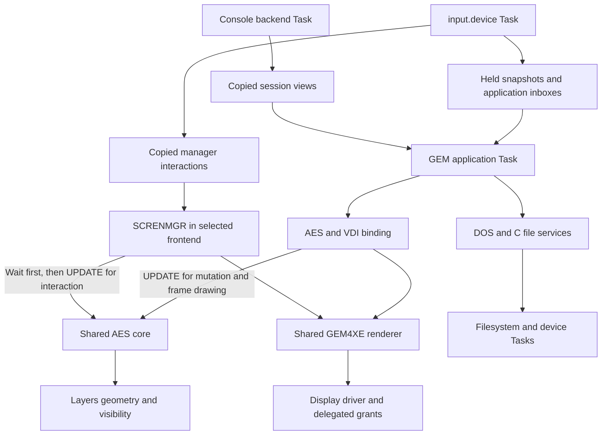

# GEM-first GUI on Exec816

[GEM plans](README.md) · [Source compatibility](gem-source-compatibility-plan.md) ·
[Current AES contract](../../reference/aes.md) ·
[Filesystem execution](../../architecture/filesystems.md)

Status: target design, originally 2026-11-10; migration boundary updated
2026-11-16. This note records the agreed direction after
the [two-Counter MagiC demo](../../guides/atari-st-reference.md#two-counter-applications).
It describes a target architecture; the current reference contracts remain
authoritative until executable migration slices replace their implementations.
The [implementation plan](gem-first-gui-implementation-plan.md) assigns GF0–GF15
executable slices, beginning with native I/O coexistence and resource accounting.

## Decision and scope

Direction updated 2026-11-15: follow the
[governing MagiC port guidance](../../contributing/README.md#gem-architecture-guidance).
Port MagiC's GUI structure and flow over Exec platform services, with GEM4XE as
the primary graphics code quarry. The original design and GF0–GF15 record what
was proposed and delivered; their existing boundaries do not become the target
by default. Review the [current deviations and platform gaps](../../architecture/magic-exec-mapping.md#current-deviations-to-review).
Architectural departures require a concrete reason and a user decision before
implementation. Report missing platform services rather than building GUI-specific
substitutes. Current runtime contracts remain unchanged by this direction note.

The user has selected replacing the combined presenter with MagiC's SCRENMGR
role. The [migration plan](screnmgr-migration-plan.md) narrows the manager to
interaction work, moves ordinary frame painting into the calling AES operation,
and requires independent input/device progress when the manager blocks on UPDATE.
The [input migration](../../history/input-device-migration.md) now provides
independent capture and copied delivery. The selected GUI frontend becomes
SCRENMGR; input, console backend and frontend occupy three service Tasks within
the existing map. The combined AESSYSTEM loop remains only during the staged
scene/caller-operation migration. Its turn-wide scene ownership is not the target.

Make GEM the graphical application interface. AES owns every graphical window,
including the desktop's and terminal's windows. Application bodies use ordinary
AES/VDI calls, object trees, resources and event loops. Keep platform startup,
integer/pointer ABI differences, paths and unavoidable porting changes in the
shared SDK or a small application adapter.

Use MagiC's implementation as the structural and execution-flow baseline for
the GUI, mapping its responsibilities onto Exec services. Preserve Exec's Amiga-style
Tasks, signals, ports and request/reply device I/O beneath it. Keep the current
scheduler and normal Task preemption during rendering. This design introduces
no GUI-specific kernel operation, scheduler policy or new compiler dependency.

The target removes the native graphical window and retained-widget interface.
Console streams, retained terminal cells and text boot/recovery remain useful
backends. Desktop, Files, terminal, Control Panel and other graphical tools
become GEM clients. The existing 640×240, sixteen-colour mode and 8×8 font remain
the initial display target.

This is rebuilt-source compatibility. ST binaries, full AES/VDI coverage,
arbitrary callback support, memory protection and recovery from corrupted
applications are outside this design. Unsupported APIs continue to fail
explicitly. Bounds on applications, windows, workstations and resources remain
documented and measured; additional upper RAM does not remove bank-zero limits.

## Evidence and the MagiC boundary

The Hatari demo runs the unchanged Counter body in two MagiC processes. Both
advance and paint while one window is inactive. This is the accepted behavior
reference for independent application event loops. It does not establish native
Exec disk coexistence, pointer latency or complete GEM compatibility.

The [shared-source comparison](../../history/atari-st-reference.md) and
[native drawing profile](../../history/aes-drawing-profile.md) identify repeated
object setup and ownership callbacks as optimization candidates. Different CPUs
and display formats prevent a direct speedup prediction from the ST timings.

MagiC's `AESOBJ.S` draws a tree through direct AES routines; `AESEVT.S` supplies
recursive UPDATE ownership, waiting applications and explicit I/O waits.
`MAGIBIOS.S` skips timer-driven suspension when the interrupted code is in
supervisor mode. Exec cannot assume that execution boundary: its caller-side
renderer remains preemptible and must explicitly serialize shared state.
The pinned [object walker][magic-objects], [events and waits][magic-events] and
[BIOS timer path][magic-bios] are architectural references, not code to install
as a replacement kernel.

## Ownership and execution

The existing implementation already has one shared scene and delegated
caller-side drawing. The change removes parallel native/GEM policy and moves
suitable window operations into one shared AES core.

| Owner | Responsibility |
| --- | --- |
| Application Task | AES parameters, event/timer resources, model, workstation and ordinary synchronous AES/VDI execution. A frame setter completes its visible painting before releasing its handler UPDATE. |
| Shared AES core | Window identities, geometry, stacking, focus, menu policy, redraw obligations and UPDATE/MCTRL. Live scene mutations and their retained effects have explicit UPDATE authority. |
| input.device Task | Source acquisition/consumption/release and bounded native delivery. Consumers publish inbox readiness from copied routing without UPDATE, live scene traversal or drawing. |
| SCRENMGR / selected frontend | Wait for manager events, obtain UPDATE for menu/frame interaction and release at MagiC's operation boundary. The current frontend retains display lifetime until the remaining migration assigns every continuation. |
| Console backend | Stream requests, input translation and retained models. It performs no GUI drawing and does not depend on UPDATE. Standard text/standalone bitmap selects its own frontend instead of GEM. |
| Layers | Geometry, visibility and damage under the AES operation's authority; no separate window policy. |
| Renderer/display | Delegated physical access, shared scratch, overlays, VRAM mapping and completion/fault lifetime. Ordinary Task preemption continues while a grant is held. |

Do not add a Task per window, dialog, timer or draw. IM0–IM8 consumes one extra
ordinary occupied pool relative to the former combined two-service arrangement;
reserved bank-zero bytes are unchanged. A workstation belongs to its application,
not one window. Rendering intersects damage, work and visible rectangles.

The current shared caller operations retain the scene gate during staging.
SM1e completes `WF_NAME`/`WF_INFO` using MagiC AESWIN 2417–2461: reject a missing
component, update text/frame state, draw an open linked object, then release
UPDATE. Hidden/unlinked objects need no physical access. An iconified title is
still linked; iconified info is retained without drawing. Existing owned bounded
text buffers, cold display delegation and equal-value returns remain.

Independent input now proceeds while manager/display ownership waits. Capture
does not paint the pointer; the display owner renders the copied cursor state.
The final manager loop can block on UPDATE only after scene readers and retained
physical/caller effects have their SM3 owners. Merely putting the old combined
loop in the selected context does not complete this design.

Shared code uses explicit application contexts, with no unprotected global
current-client pointer. Audit donor/compiler scratch and the C/native bridge
before moving an entry into a second Task. Establish resources at registration
or open; trust valid live caller pointers thereafter. Keep normal operational
errors, lifetime holds and synchronization without repeated defensive checks.

## Logical and physical ownership

The target has application UPDATE/MCTRL and physical access, with short copied
publication guards between them. UPDATE serializes shared UI mutation and pins
geometry across drawing; MCTRL selects input ownership. A physical grant protects
renderer scratch and hardware, including completion, without granting UI authority.
Neither scope disables normal Task preemption.

AESGATE is the interim mechanism for live scene readers/writers and continuation
handoff. It must disappear as one complete ownership cutover, not become a second
permanent UI semaphore. Before removing it, SM3 assigns queries, registration,
publication, input-window binding, journals/cache and retained effects as well as
setters. MagiC queries do not simply Obtain UPDATE: preserve `wind_get`'s copied
views and explicitly resolve `wind_find` coherence without importing pointer
routing's focus/menu/MCTRL filtering. Changed read semantics or architectural
departures require the user's decision under the governing guidance.

A caller retains its operation/UPDATE across frame painting and delegated access.
No renderer may wait for a scene/AES reply required to free its own grant. A
manager must not Obtain a caller's semaphore to complete that caller's retained
effect. Cache/physical continuations require owners and retirement before the
final SCRENMGR wait loop; no new GUI-specific platform service is assumed.

### SM3a selected read boundary

MagiC AESWIN `wind_find` (2812–2838) walks `whdlx` and current window rectangles
without UPDATE, focus, menu or MCTRL routing. MagiC's supervisor execution
boundary prevents arbitrary timer-driven dispatch inside that walk; Exec keeps
normal Task preemption. A Forbid around the reader alone cannot repair a writer
already paused between related geometry/stacking stores. Adding UPDATE to the
query would change the source flow.

The user selected the committed raw hit snapshot on 2026-11-16. SM3a implements
that boundary; the alternative below records the rejected live-write refactor.

| Choice | Read and publication contract | Cost/dependency |
| --- | --- | --- |
| Committed raw hit snapshot (recommended) | Query the last complete published scene. A query overlapping mutation may return the previous stack; after operation completion it sees the new publication. Use a separate raw-hit read over AESSNAPSHOT rows, with no pointer-routing focus/menu/MCTRL filtering. | Reuse existing bounds/order/window/handle rows: zero additional buffer, Task or bank-zero reservation. All scene operation return/retirement boundaries must publish before releasing their authority. |
| Live geometry with guarded commits | Query current scene bounds/order while holding a short Task guard. Every corresponding writer must commit the hit-test fields and window-handle association atomically before a query can run. | Refactor and audit all lifecycle, move, stacking, iconification and native-layer publication boundaries. Heavy visibility calculations and drawing must remain outside Forbid. No second scene lock. |

SM3a preserves native/chrome occlusion and separates raw window identity from
work-area input eligibility, including endpoint close. Iconified windows return
their handle, following MagiC's unfiltered stack walk. The previous Exec tile
exclusion is removed; the existing zero result outside AES windows remains. Readiness and scene construction still need
the rest of SM3's ownership inventory; either choice alone cannot remove AESGATE.
The selected contract permits the previous complete publication during an
overlapping mutation. Completed operations must publish before return. It adds
no buffer, Task or bank-zero reservation and does not acquire UPDATE in queries.

Contention sleeps through ordinary Exec signals/ports. Publish waiters before
release can wake them, recheck after waking, and treat signals as hints. Use
short `Forbid` sections only for Task-side owner/waiter transitions, never for
the entire drawing operation. Preserve the existing IRQ/NMI protocols for
interrupt-shared state; `Forbid` does not replace them.

Start from the [current display arbiter](../../reference/display.md#delegated-renderer-access).
Keep one lifetime owner, delegated grants, FIFO admission, fences and retained
storage on an unquiesced hardware fault. A wider library transaction must not
bypass driver admission or make command buffers reusable before completion.

Prepare object decoding and layout once where it is safe. Reuse that prepared
description across visible fragments. Prefer object/VDI-operation boundaries
for drawing units, splitting further when measured work, scratch capacity or
input latency requires it. Existing strip and command limits remain until a
separate measured slice changes them. Preemption alone does not release renderer
ownership, so larger units need explicit latency and SIO coexistence checks.

Internal renderer callbacks are bounded implementation helpers. They perform no
file I/O, event wait or synchronous AES request. Application callbacks must run
in their owning Task; enabling them requires a separate contract for nesting,
VDI state, ownership and stack use. This note does not advertise them as supported.

## Redraw and application portability

Conventional `WM_REDRAW`, `wind_update`, `WF_FIRSTXYWH` / `WF_NEXTXYWH` and VDI
clipping are sufficient for correct application drawing. Hidden model changes
remain the application's responsibility. Event queues and pending redraw facts
must survive a delayed client or a full ordinary application-message queue.

Use conservative exposure redraw as the correctness baseline. Ending UPDATE,
exhausting visible rectangles or retaining unchanged geometry does not prove
that an application reconstructed its content. Native repaint/completion
extensions and backing caches must not be mandatory for ordinary GEM clients.
Existing preservation paths can remain during migration; any retained
optimization needs an explicit content-validity proof and a correct miss path.

Keep retained terminal cells and application models in their owning backends.
They are sources for repaint, not a second GUI window system. Compare source
ports by their remaining patch set and observable events/pixels, not merely
matching function names or headers.

## Lifetime and retirement

Keep application code, contexts and referenced storage alive through active GEM
entries, message publishers, deferred GUI work and drawing completion. Preserve
the [current AES retirement rules](../../reference/aes.md): withdraw admission,
retire windows and service-originated events, drain publishers/queues and release
ownership before freeing registration storage. Closing a window must not depend
on its application first consuming obsolete notifications.

Cancel and collect retained timers and I/O before freeing their requests or
buffers. Retire delegated display grants through the existing driver protocol;
the lifetime owner cannot close while a borrower or hardware access remains
live. An application exit and whole-service shutdown have different scopes.
Keep normal cleanup and failure retention executable; do not infer safe forced
Task removal from orderly-exit tests.

## I/O and the terminal

A synchronous file read follows the existing path: application, shared filesystem
Task, SIO worker, native IRQ transfer, then replies to the waiting caller. Other
runnable Tasks can continue. The filesystem still processes one active operation
across mounts, and SIO still serializes the physical bus. This design does not
make either service parallel.

Resource-file loading, application file operations and C stdio execute in the
calling application's DOS context. The AES system Task does not perform those
operations on its behalf. Shared scene and physical drawing ownership never span
disk waits. Applications should release UPDATE before long I/O: holding it can
block peers' redraws even while the CPU and disk continue. Do not silently drop
an application's logical ownership around a blocking call.

Synchronous I/O pauses that application's own event loop. A Counter doing a long
read therefore pauses its own count; independent counters should keep advancing.
Applications needing their own responsive long jobs can use bounded operations
between event handling or an explicit worker with its own I/O context and a
completion message. Account for its Task and any extra AES registration. The
existing [combined Exec/AES wait](../../reference/aes.md#combined-gui-and-exec-wait)
remains optional; ordinary GEM source does not acquire a new native requirement.

Preserve device request, buffer, binding and reply-port lifetimes until terminal
completion is collected, including after cancellation. Device/driver code owns
queue and cancellation policy through public Exec primitives. No GUI-specific
completion service or driver-private kernel shortcut is introduced.

Separate the console's stream, retained-cell and cooked-input backend from its
graphical frontend. A GEM terminal owns ordinary AES windows and repaints from
that model. Preserve foreground cancellation and CON/pipe behavior. Stream
acceptance must not require synchronous terminal painting that needs UPDATE
held by the producer; retain explicit buffering/backpressure and completion
semantics. The existing worker split and any additional frontend Task require
an executable lifecycle and memory budget before migration.

## Migration boundaries and acceptance

Begin the implementation plan with a native baseline: two independent Counters
beside sustained disk reads/writes. Reuse the
[existing I/O/GUI workloads](../io-latency-implementation-plan.md) and add only
the missing combined scenario. Pin the actual ROM, emulator, compiler, machine,
media and workload. Preserve previous latency limits and failures; functional
passes do not close the existing open latency gates.

Require independent counter progress, correct read/saved bytes, continued pointer
capture/event delivery, bounded completion, cancellation/collection and normal
cleanup. Record input-to-pixels latency, caller/system CPU, scheduling delay,
UPDATE/display contention and disk progress. Check guards, context restoration,
heap/Task/resource retirement and ownership. Logs stay outside measured drawing
and I/O intervals. Counter increments are liveness evidence, not a wall clock.
Use a controlled long I/O call to distinguish the blocked caller's pause from
peer progress; retain a separate UPDATE-held contention case.

Then migrate one window-operation family at a time into the shared core, followed
by the AES system Task role and conversion of native graphical clients. Preserve
one authoritative scene throughout. Temporary native callers use that same core;
remove each obsolete operation/path with its callers once its replacement lands.
There is no permanent second window API or compatibility implementation. Change
renderer preparation/batching in separate slices so policy and rendering costs
can be assessed independently. Rebuild bindings and applications together when
their ABI changes. Commit each executable slice after its selected checks.

Use development-tier host checks and focused optimized emitted-code tests.
Add small raw/optimized probes only for compiler-facing ABI/bridge changes.
Compare overlapping-window pixels, events, geometry and lifetime behavior;
retain loaded SIO checks when ownership or rendering intervals change. Hatari
host-folder logging does not qualify native SIO, physical drives or hardware.
An Exec demo refresh must use `tools/build_demo.py`, include OF816 and preserve
the standard five-second autoboot.

This documentation change adds **0 fixed/root/kernel, 0 per-public-Task and
0 idle reserved bank-zero bytes**, including guards, alignment and unused
capacity. Implementation slices must report their own reservations and measured
stack use. Identify which existing Task becomes the AES system Task, whether
console/backend/frontend separation adds Tasks, and whether two clients plus
filesystem, SIO and the test workload fit the admitted pool. Count full reserved
stack/DP capacity and guards, not only live payload. Justify and record any Task
or bank-zero pool growth in its implementation slice.

[magic-objects]: https://gitlab.com/AndreasK/Atari-Mac-MagiC-Sources/-/blob/28cfdd29aa16fef692cc287bad3046b44ddcce3d/MagiC/KERNEL/AES/SRC/AESOBJ.S
[magic-events]: https://gitlab.com/AndreasK/Atari-Mac-MagiC-Sources/-/blob/28cfdd29aa16fef692cc287bad3046b44ddcce3d/MagiC/KERNEL/AES/SRC/AESEVT.S
[magic-bios]: https://gitlab.com/AndreasK/Atari-Mac-MagiC-Sources/-/blob/28cfdd29aa16fef692cc287bad3046b44ddcce3d/MagiC/KERNEL/BIOS/ATARI/MAGIBIOS.S
