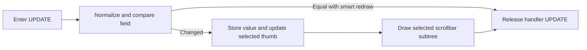

# MagiC window geometry for MGVIEW

[GEM plans](README.md) · [MagiC model](../../architecture/magic.md) ·
[Port guidance](../../contributing/README.md#gem-architecture-guidance) ·
[Current measurements](../../history/gem-slider-drawing.md)

Status: proposed design, 2026-11-16. The user selected MGVIEW as the sole
application acceptance target and authorized breaking other existing apps.
Geometry must follow MagiC's structure and flow closely. The frame model and
consumer changes below are proposals, not implemented behavior. The current
[AES reference](../../reference/aes.md) remains the runtime contract.

## Direction and scope

Port MagiC's geometry responsibilities into the existing caller AES/SCRENMGR
execution map. Use GEM4XE rendering implementations and artwork beneath that
structure. MGVIEW keeps standard GEM calls; introduce no viewer-specific
geometry API. Update bindings and rebuild affected binaries as needed. Other
apps are later migration work, not a reason to retain parallel geometry paths
or compatibility modes.

Previously selected foundations remain: native recursive UPDATE, normal Exec
Task preemption, independent input.device capture/delivery, SCRENMGR interaction
and committed hit-stack reads for `wind_find`. No new Task, scene gate,
scheduler policy or platform service is proposed. Report a demonstrated missing
platform capability before implementing a substitute.

The scope is frame creation/layout, move/resize geometry, slider setters and
their rendering/hit-test consumers. The separate END_UPDATE window-cache policy
and full AES coverage are outside this refactor.

## Source baseline

Use MagiC revision `28cfdd29aa16fef692cc287bad3046b44ddcce3d` from the
[reference pin](../../../toolchain/atari-st-reference.json). The
[source record](../../development/magic-architecture.json) supplies exact hashes
and locators. These are normalized text lines in [AESWIN.S][AESWIN], except
the window record in [AESINC.S][AESINC].

| MagiC source | Responsibility to port |
| --- | --- |
| `WINDOW`, `w_curr`, `w_work`, slider values and `w_tree`; AESINC 232–247 | A window owns its logical geometry and frame tree. |
| `_wbm_create`, `_wbm_skind`; AESWIN 414–812 | Construct standard frame objects and link those required by the kind. |
| `_wbm_ssize`; 994–1203 | Set the root origin; recompute frame/work/track layout when dimensions require it. |
| `__sslid`, `_wbm_sslid`; 909–966 | Use MagiC's rounded scaling and minimum/default rules for the selected axis. |
| `ws_slide` / `ws_slend`; 2733–2794 | Normalize and compare the field, update its axis, draw its scrollbar under UPDATE, then release. |
| `wind_draw` / `objc_wdraw`; 221–389 | Draw the selected subtree through window visibility clips. |
| `_wbm_obfind` / `wind_was_clicked`; 2970 onward | Interpret frame clicks using that same tree. |

GEM4XE remains the graphics quarry at revision
`e413c39d2f8e1bec8fe16596f610b923de4a0ae9`. Its
[window reference](../../../ports/gem4xe/window-reference.json) pins
`src/aes/wind.c`: layout at 515–572 and selected scrollbar drawing at
1237–1273. Reuse the object raster, gadget images and VBXE facilities;
do not import GEM4XE's single-task execution assumptions.

## Authoritative geometry and operations

Each AES window owns current/work geometry, per-mille slider values and a
standard GEM frame tree. Preserve MagiC's object identities and relative
parent/child coordinates, including `O_VSCROLL`/`O_VSLIDE` and
`O_HSCROLL`/`O_HSLIDE`. Kind-dependent linking selects active objects. Do not
specialize the model for MGVIEW's coordinates or document length.

Painting, dragging and frame hit-testing consume stored tracks and thumbs.
Layers/Regions derive visibility from committed outer bounds; they do not
define frame layout. Query/routing copies are projections needed by their read
contracts, not independent geometry calculations.

Replace `sliderTop`, `sliderHeight`, `sliderLeft` and `sliderWidth` and repeated
track construction in paint/drag paths as their consumers migrate. Remove
generic geometry freshness fields when no remaining consumer needs them.
Initialize frame storage before publishing a window, retain it across ordinary
close/open, and retire it on delete after events and physical borrows no longer
reference it. Reuse current upper-memory allocation and lifetime services.

| Trigger | Geometry work |
| --- | --- |
| Create, resize or change frame kind | Construct/link objects, compute work and arrow/track layout, then calculate the linked thumbs. |
| Move without resizing | Change the root origin and affected window/visibility projections; retain relative track/thumb geometry. |
| Change slider position or size | Use the selected track's existing length; calculate only that thumb's size and relative position. |
| Paint, drag or hit-test | Read stored objects, applying parent origins and visibility clips where needed. |

Port MagiC's value normalization, unchanged-value behavior, rounded scaling,
axis-specific minimum thumb extent and default-size handling, including size
`-1`. Position and size setters share the selected-axis routine. MGVIEW
continues issuing its ordinary size call followed by position. Full layout may
update both axes; a slider setter does not.

Map platform font/device metrics to MagiC's `gr_hwbox`/`gr_hhbox`. The
implementation plan must specify that mapping and pixel differences from
current Exec padding/minimums. Preserve source object relationships and
arithmetic rather than silently retaining different pixel rules. Use existing
compiler/runtime arithmetic for required wide intermediates on the 65816.

The selected-axis calculation mutates geometry only: no allocation, pixel-cache
policy, global routing rebuild, other-window scan or physical drawing. The AES
handler owns the operation:

## Rendering, input and preemption

**Rendering.** A frame draw takes the tree, start object and clip, using frame
visibility rather than the application's work-only clip. Replace the current
generic-frame traversal under a narrow clip with actual selected-subtree
drawing. The raster consumes stored geometry. Reuse GEM4XE primitives and
trusted built-in gadget renderers; this does not add arbitrary application
USERDEF support. Existing physical grants, fences, scratch and fault lifetime
remain driver responsibilities. A language-bridge packet, if needed, carries
the canonical tree/selection/clip rather than another set of thumb coordinates.
Setters still finish drawing in their caller before releasing UPDATE.

**Frame input — proposed change.** Today the AES input path copies thumb
coordinates and classifies some gadgets before SCRENMGR, which performs another
live hit-test. Move object interpretation into SCRENMGR's UPDATE-owned
interaction, following `_wbm_obfind`. Independent delivery retains coordinates,
buttons and the existing target identity/epoch/endpoint lifetime. It must not
wait for UPDATE or follow live frame pointers. Preserve work-area input,
MCTRL, loss/cancellation and queued-target retirement across this cutover.

SCRENMGR interprets the queued point against the current protected frame tree
when it processes the interaction. This explicitly replaces capture-side
copied-thumb classification. Remove thumb coordinates from routing snapshots;
a slider-only change then needs no full input-routing rebuild. Layout, focus
and lifetime changes still publish the facts that delivery requires.

**Exec preemption.** Mutations and live frame consumers retain UPDATE across
normal Task preemption. Reads outside UPDATE consume a complete published
value copy using existing short publication/lifetime guards. Forbid around a
reader alone cannot make a paused, partially completed writer coherent.
`wind_find` retains committed-stack semantics; a slider-only change alters
neither the stack nor window bounds. Introduce no whole-layout Forbid section
or IRQ/NMI access to live frame objects.

View publication and pixel completion/cache bookkeeping remain separate from
geometry. Removing their calls from a geometry helper does not authorize
unsafe readers or adopt the current cache protocol as MagiC's. Any temporary
cache handling stays at its owning operation boundary. Removing END_UPDATE's
window-cache maintenance is a separate design/implementation slice.

## Adoption and resource accounting

Settled direction: MGVIEW-only acceptance, MagiC structure/flow and existing
Exec execution/ownership services. This note proposes the authoritative frame
tree, selected-object rendering and SCRENMGR frame-hit boundary together.
The implementation plan must fix metrics, query/routing projections, allocation
layout and retirement order. Identify additional departures from MagiC for a
user decision under the governing port guidance.

The GEM object representation is 24 bytes, also represented by
`AESTYPES.MenuObject`. A 16-object frame needs **384 bytes per window** for
its tree alone. Embedding trees in the current six reserved window records
would require **2,304 gross upper-memory bytes** before removing old fields.
These are estimates, not a selected layout or net measurement. Account for
specifications/text bindings, alignment, read copies and removed storage.
Reuse one object definition and generate shared ABI changes from
machine-readable inputs.

No new Task, signal, VRAM/scratch reservation or bank-zero storage is planned.
The implementation target is **0 fixed, root, kernel, idle and per-public-Task
reserved bank-zero bytes added**, including DP, guards, alignment and spare
capacity. Measure actual reservations and stack peaks per slice. This
documentation-only change itself adds zero reserved bank-zero bytes and makes
no executable or memory-admission claim.

## Implementation boundaries and acceptance

Proposed boundaries for a later implementation plan, not delivered slices:

1. Port frame records, creation/kind/full-layout and move behavior; connect
   geometry queries and verify one window through resize/move.
2. Port selected-axis setters and rounding/minimum/default rules using stored
   tracks. Remove the generic geometry/publication call from this path.
3. Connect selected-object drawing and SCRENMGR frame hit-testing, remove old
   fields/consumers, and complete MGVIEW acceptance.

Keep commits executable. Update callers and focused fixtures together; do not
maintain old geometry as a compatibility mode. Rebuild the provider and MGVIEW
when their ABI inputs change.

Development checks cover emitted geometry for both axes, the unchanged axis,
equal values, rounding/minimum/default boundaries, resized tracks and an
origin-only move. MGVIEW acceptance covers open/close, resize, both-axis
scrolling and thumb interaction, exact pixels, restoration, guards and stack
floors. If input placement changes, add one focused case for independent key
delivery while SCRENMGR waits on UPDATE and safe retirement of a queued frame
click. No additional application is an acceptance dependency.

Use a small matched down/up observation to separate geometry, publication,
rendering, elapsed/off-Task and completion costs. Two actions do not establish
a latency distribution. No QED, old application/frame matrix, catalog, demo
refresh or release/raw matrix is implied. A future requested demo still follows
the repository's OF816 packaging rules.

[AESWIN]: https://gitlab.com/AndreasK/Atari-Mac-MagiC-Sources/-/blob/28cfdd29aa16fef692cc287bad3046b44ddcce3d/MagiC/KERNEL/AES/SRC/AESWIN.S
[AESINC]: https://gitlab.com/AndreasK/Atari-Mac-MagiC-Sources/-/blob/28cfdd29aa16fef692cc287bad3046b44ddcce3d/MagiC/KERNEL/AES/SRC/AESINC.S
