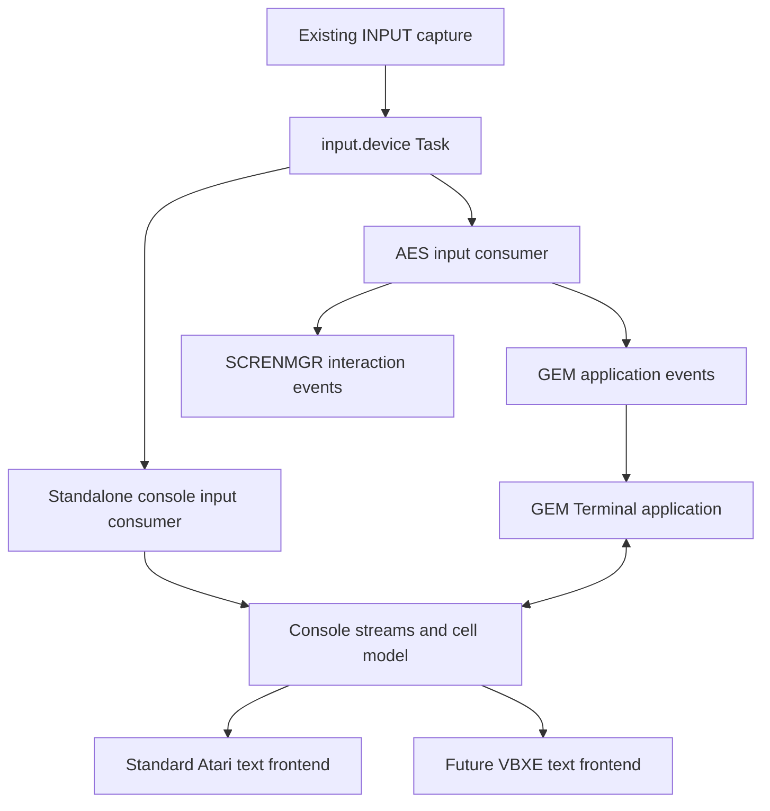

# Independent input.device

[Plan index](README.md) · [Current INPUT contract](../reference/input.md) ·
[Device I/O](../reference/device-io.md) ·
[Console](../reference/console.md) · [Display ownership](../reference/display.md) ·
[SCRENMGR migration](gem4xe/screnmgr-migration-plan.md)

Design draft, 2026-11-15. The user selected a Task-based input service, reusing
the existing resident console/system Task, independent of AES and SCRENMGR.
It must support a standard Atari text console, a future VBXE text-mode console
and GEM. This note proposes the delivery interface and migration boundaries;
`input.device` is not implemented and the current INPUT contract is unchanged.
The [IM0–IM8 migration plan](input-device-migration-plan.md) sequences the work,
including the remaining frontend execution-placement decision and resource costs.

## Role and dependencies

`input.device` owns physical input capture, source lifetimes and delivery to
registered consumers. It uses ordinary Exec Tasks, signals, messages, device I/O
and the existing INPUT library. It starts and operates without AES, SCRENMGR,
desktop state, a display lease or an initialized graphics backend.

| Component | Responsibility |
| --- | --- |
| Existing INPUT library and native capture | Hardware decoding, captured source/route identities, timestamps and durable loss/cancellation. Preserve the existing IRQ/NMI publication protocol. |
| input.device Task | Acquire, drain and release input sources; service control requests; dispatch captured events to the registered consumer. Sleep when no work is pending. |
| AES input consumer | GEM key translation, application/window focus, copied routing publications, event readiness and delivery to applications or SCRENMGR. |
| Console input consumer and console backend | Translate keys for console streams, route to the active session and service raw/cooked reads. Keep editing, EOF and foreground-process cancellation in their existing console/DOS layers. |
| SCRENMGR | Wait for interaction events; obtain UPDATE for actual menu/frame interaction; release it at the MagiC operation boundary. |
| Display frontends | Render the standard Atari text screen, future VBXE text screen or GEM Terminal window. Own screen geometry, visible cursor and physical display work. |

The device has no imports from AES, DESK modules or console renderers. A
consumer installs an explicit generic handler; its code and state belong to
that consumer. Loading GEM registers the AES consumer. A standalone console
registers the console consumer and requires no GUI initialization.

These are consumer paths, not a broadcast to every frontend. The active
frontend/router owns each source binding. AES routes GEM input among its
applications, including Terminal. In standalone text operation, the console
consumer routes keyboard input to the active console session.

## Execution and delivery

The existing console/system Worker becomes the input service context after
its GUI and display responsibilities have been relocated. This selection adds
no separate input Task. CONSOLEBACKEND is already a different Task; it retains
stream/model processing. Making Terminal an ordinary GEM application does not
remove that backend or automatically provide SCRENMGR's execution context.

The draft recommends a bounded, synchronous **consumer handler** invoked by
the input Task in ordinary Task context. This provides immediate AES event
publication without requiring another Task solely to drain a device event
queue. The handler can copy data, perform bounded routing, publish messages and
signal existing consumers. It returns before dispatch continues.

The handler must not Wait, acquire UPDATE/MCTRL/AESGATE, enter a display grant,
perform I/O waits, draw, or execute an application callback. It uses short Task
guards only around shared publication. The device holds no queue guard across
the call. Normal Task preemption remains enabled. The handler's execution cost
and stack peak are part of the input service's measured budget.

For GEM, the handler uses retained copied routing/endpoint state and publishes
ordinary application events. It queues manager interaction for SCRENMGR.
SCRENMGR can therefore sleep on UPDATE while input delivery continues. Live
window/menu changes and physical cursor drawing execute outside this handler.
The existing DESKINPUT.Service/Present routines combine several of these roles
and cannot simply be renamed or called wholesale from the new device.

For a standalone console, the handler copies keyboard events into the existing
console ingress path and wakes CONSOLEBACKEND. It services console.device
requests and translated input queues. The [DOS cooked adapter](../reference/cooked-console.md)
retains line editing, echo and session ownership above console.device. Neither
output rendering nor a blocked read stalls the input service. In GEM mode, AES
supplies Terminal/session input through the normal application/console path;
a second console sink does not compete for the same keyboard.

An asynchronous event-read interface is a possible later consumer adapter.
Using reads for the AES router would also require a receiving execution context
that remains runnable while SCRENMGR blocks. This draft recommends the handler
boundary to avoid adding that scheduling dependency. An arbitrary prioritized
handler chain, global event observers and input injection are outside the first
service design.

## Proposed device interface

Publish a resident `input.device` through ordinary OpenDevice/CloseDevice and
the existing request submission/completion rules. Driver-owned registration and
dispatch need no new kernel callback facility. Resident registration remains
the current static platform mechanism; consumer handlers are device-owned
registrations, not dynamically installed kernel drivers.

| Operation | Proposed semantics |
| --- | --- |
| Open/query | Admit a live device binding and report available sources/capture capabilities. Opening alone does not claim keyboard focus or start a display. |
| Attach consumer | Claim the requested available sources and install an address-stable handler/context. A conflicting source returns BUSY. Claiming a source set succeeds completely or leaves existing owners unchanged. |
| Manage capture routes | Reserve, publish and retire opaque source route tags through the admitted binding. Preserve capture-time identity and explicit exhaustion. The device does not interpret a tag as a window, application or console session. |
| Detach consumer | Stop new dispatch, settle captured records and references, then acknowledge that the handler/context can be released. |
| Abort/collect | Cancel pending control work using AbortIO followed by normal completion collection. Exactly one non-quick completion is required, including cancellation. |
| Close | Release an open after its consumer is detached and all requests borrowing the binding have been collected. Close does not wait for an active handler. |

Attach/detach work that needs the input Task is queued and completes through
ordinary I/O replies. Cancellation before a control operation's commit point
leaves the registration unchanged; after commitment, normal completion wins.
An attached consumer needs explicit detach even if AbortIO raced its successful
attach. A route publication must have a bounded, nonwaiting completion path so
a consumer can establish its capture boundary together with its own routing
publication. Existing INPUT permits cross-Task route operations through a
retained lease; acquiring, taking and releasing remain input-Task-only. The
implementation plan must specify the exact publication/retirement ordering.

Commands, extended request/handler layouts, callback ABI, source limits and
queue capacities remain to be specified in machine-readable ABI definitions.
Generate the shared language declarations when implementing them. The existing
24-byte INPUT event and 32-byte lease/configuration are low-level contracts;
they do not silently become the new device's application ABI.

Validate storage/options and establish lifetimes at open/attach. Established
calls trust live caller-owned requests and registrations. Preserve normal
errors such as unavailable hardware, BUSY, exhausted routes and allocation
failure, without adding repeated pointer/handle validation through every layer.

## Event and routing semantics

- Deliver the source, capture generation/route, capture tick, supported physical
  key code/qualifiers or relative pointer movement/buttons, and explicit loss
  or capture cancellation. Report hardware capabilities honestly; key-release
  events cannot be promised where the capture backend does not provide them.
- Character encoding, GEM scan/ASCII pairs, shortcuts, Ctrl-C, Escape, cooked
  editing and foreground-process BREAK are consumer policy. A physical BREAK
  capture is an input event, not permission for the device to select a Process
  to cancel. The consumer may select generic raw-key cancellation filters and
  unfiltered routes using the existing INPUT mechanism. Keep shortcut constants
  out of the device and preserve durable cancellation and raw-input semantics.
- Pointer acceleration, screen coordinates, clipping, pixel/cell conversion and
  pointer shape belong above physical capture. Use the existing relative mode
  without embedding the GEM display's dimensions in the device.
- Bindings/routes have nonrepeating identities. Captured input retains its
  original route across focus changes and detach/reopen. A consumer may use
  multiple opaque tags for its own recipients; the device never reads its
  application/window/session records. Reuse the existing route/loss machinery
  rather than adding a second identity protocol.
- Queues are bounded. Overflow produces a durable loss indication and a defined
  resynchronization boundary; it must not silently invent button/key edges.
  Preserve durable cancellation independently of ordinary FIFO capacity. Prefer
  draining existing capture queues to adding another full event ring.
- The handler receives a borrowed event valid for that call. Consumers copy
  what they retain and hold any addressed endpoint until delivery or discard
  has retired. A signal is a wake hint; pending work remains in owned storage.

Frontend handoff first stops old addressed capture, settles or explicitly
discards old-route events, detaches the old consumer, then admits and publishes
the new consumer. Held-key/button state needs an explicit resynchronization
boundary. Input captured for the previous frontend must never become a command
in its successor. Display ownership is a separate handoff with its own fences.

## Console frontends

| Frontend | Input path | Display/model responsibilities |
| --- | --- | --- |
| Standard Atari text console | input.device → console input consumer → console backend | Preserve the existing 40×24 text backend and its OS coexistence/restoration contract. It must work without AES, SCRENMGR or VBXE. |
| Future VBXE text-mode console | Same standalone console input path | Share console streams, cell model and editing; provide its own VBXE text renderer and display ownership. This is separate from the existing 80×30 bitmap console. |
| GEM Terminal | input.device → AES routing → Terminal/session input | Terminal is an ordinary GEM application, paints with AES/VDI and consumes console views. The console backend retains the stream/model APIs. |

Rendering owns fonts, cells/attributes, scrolling, caret and pointer appearance.
The input service owns none of the TEXT/VBXE display leases, delegated drawing
grants, blitter fences or OS screen restoration. In particular, physical cursor
work must not delay input delivery while waiting for the drawing owner.

The standard Atari text path is a required migration acceptance case. The VBXE
text-mode frontend is a future consumer requirement, not an implementation in
this slice. Its hardware mode, fonts, geometry and VRAM budget need a separate
renderer design.

Existing display backends are selected at startup; live conversion is currently
unsupported. Initially preserve startup selection. A later live GEM/text switch
must separately quiesce/release/acquire the display and switch input consumers;
the resident input service can remain alive throughout. This note does not
promise Linux-style virtual terminals or simultaneous fullscreen display owners.

## Synchronization and lifetime

The input Task alone acquires, drains and releases each low-level INPUT lease.
Startup acquires only configured, available sources and unwinds a failed
acquisition prefix. Keyboard-only Atari text operation must not depend on mouse
availability or a VBXE display probe.

IRQ/NMI continues to capture through the current native protocol. Forbid covers
Task peers, not asynchronous capture; preserve native publication gates wherever
the current INPUT contract requires them. No consumer callback runs in IRQ/NMI
or an admitted native-completion context. No guard is held across waiting or
external consumer code.

Process bounded control/capture work per service turn and recheck durable work
before Wait. Control requests, source arrival and stop each provide wake hints.
There is no periodic idle session polling and no per-event allocation. Consumer
callbacks must remain bounded so one source cannot indefinitely starve another
or prevent detach/control requests from completing.

Attach retains the consumer's owner binding; the caller keeps handler code and
context alive until detach acknowledges retirement. The consumer initializes
all callback-visible storage before submitting attach: dispatch may begin before
the requester collects its reply. Detach is serialized after any active callback
and retires capture/route references before acknowledgment. Abort races with
completion; collect the final reply before reusing requests, ports, signals or
buffers. Consumers must detach before unloading code or releasing their state.

The service can remain resident with no attached frontend; inactive routes
discard unaddressed capture. Closing AES detaches AES, not the system input
service. Explicit system shutdown stops admission, detaches consumers, retires
requests/capture references and releases sources in the acquiring Task before
freeing storage/signals. Failed safe retirement retains the affected resources;
it does not permit a forced Task removal or ownership steal.

## MagiC mapping and platform costs

The [pinned MagiC model](../architecture/magic.md#input-events-and-application-messages)
places ordinary input delivery in scheduler-side event processing, separate from
the [SCRENMGR application](../architecture/magic.md#resident-screen-manager).
The selected Exec adaptation places capture consumption/delivery in an ordinary
Task using public Exec services. Its reason is independent input progress with
the existing Task/signal/device model and reuse of the resident console context.
It preserves MagiC's separation of ordinary event delivery from UPDATE-owned
manager interaction. It does not reproduce MagiC's scheduler internals.

The [execution comparison](gem4xe/screnmgr-execution-map.md) retains the deferred
service alternative and its missing general callback contract. That facility is
not required for the selected Task model. A new public input driver/interface
still needs implementation; the existing INPUT library is not already a shared
device. Report any further platform gap instead of adding an AES-specific
kernel service.

This documentation slice changes **0 fixed, 0 root, 0 kernel, 0 idle and 0
per-public-Task reserved bank-zero bytes**, including guards, alignment and
unused reserved capacity. It changes no upper-RAM/VRAM reservations or ABI.
The proposed input Task reuses an occupied context; it does not imply a free
Task slot or a smaller stack. The complete SCRENMGR/display/backend execution
map still needs costing before implementation. Existing ordinary and large
pools reserve 1,600 and 2,848 bytes respectively, including DP and guards; see
[Task capacity](../architecture/task-capacity.md). Measure callback/dispatch
stack peaks and upper-RAM queue/registration costs before setting bounds.

## Migration and development acceptance

The [migration plan](input-device-migration-plan.md) expands these boundaries
into separately committed slices. Its frontend placement is a proposal; Task
reuse for input does not automatically provide a display/SCRENMGR context.

1. Specify the public device/handler ABI, capture-route publication and detach
   protocol. Inventory every remaining Worker duty and name its execution owner,
   including SCRENMGR, standalone painting and outstanding physical completion.
2. Extract the generic device and repurpose the existing service Task without
   retaining the combined GUI loop. Keep console streams/models in their driver.
   Acquire/Take/Release execute in the selected source-owning Task.
3. Wire the standard Atari text console first. Exercise input, raw/cooked reads,
   output and clean detach with no AES, SCRENMGR or VBXE dependency.
4. Install the separate AES consumer. Use copied routing to deliver application
   events while SCRENMGR or an application waits/holds UPDATE. Queue actual
   manager interaction and keep cursor/drawing waits outside input dispatch.
5. Check capture loss, physical cancellation, focus/route changes, delayed
   consumers, abort/close races and consumer retirement under normal preemption.
   Preserve stack/domain guards and the native IRQ/NMI ownership boundaries.

Use host/content checks and focused optimized emitted-code cases for each
implemented boundary. Use a tiny input fixture and Counter/widget for GEM;
ABI/bridge changes also need small raw/optimized layout checks. No QED build,
application catalog, demo refresh or release qualification is required. The
future VBXE text renderer is outside these acceptance steps.

For this draft the validation scope is documentation content and local links
only. No executable input behavior, resource saving or performance improvement
is claimed.
